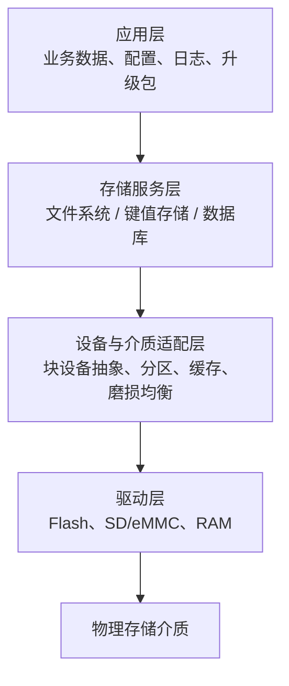

# 文件与数据存储

文件与数据存储中间件负责将底层存储介质（片内/片外 Flash、SD 卡、eMMC、RAM 等）转换为上层应用可稳定使用的文件、参数或结构化数据服务。其核心目标是在资源受限的嵌入式环境中，兼顾可靠性、寿命、性能与易用性。

## 1. 存储技术栈

| 层级 | 主要职责 | 典型能力 |
| --- | --- | --- |
| 存储服务层 | 提供面向应用的数据访问接口 | 文件读写、键值读写、查询、事务 |
| 设备与介质适配层 | 屏蔽硬件差异并处理介质特性 | 块读写、擦除、地址映射、磨损均衡 |
| 驱动层 | 操作具体控制器和存储芯片 | SPI/QSPI Flash、SDMMC、NAND/NOR 驱动 |

## 2. 核心类别

### 2.1 文件系统

文件系统将存储空间组织为目录和文件，适用于日志、资源文件、升级包和与 PC/其他设备交换的数据。

- **FATFS、FileX、emFile 等通用文件系统**：通常基于块设备工作，FAT 格式兼容性好，适合 SD 卡、U 盘或需要与 Windows/Linux 交换数据的场景。
- **LittleFS 等 Flash 文件系统**：面向 NOR Flash 等可擦除介质，重点处理擦除块、掉电恢复与磨损均衡，适合片上或 SPI Flash 中保存文件、资源和配置。
- **文件访问封装层**：可在不同文件系统和设备之上提供统一接口，减少业务代码对具体实现的依赖。

### 2.2 参数与键值存储

键值存储以 `key-value` 方式保存少量独立数据，适合设备配置、校准参数、网络凭据和运行状态等场景。相比文件系统，它通常接口更简单、空间开销更小，并能针对 Flash 写入特性进行优化。

- **NVS**：常用于在非易失性 Flash 中保存配置类键值数据。
- **FlashDB**：可提供键值数据库及时间序列等轻量数据管理能力，适合参数与设备侧小型数据记录。

> 键值存储并不适合大文件或复杂关联查询；应根据数据规模、更新频率和查询需求选择文件系统或数据库。

### 2.3 嵌入式数据库

数据库用于保存具有表结构、关联关系或复杂查询需求的数据，可提供 SQL 查询、索引和事务等能力。

- **SQLite**：自包含的嵌入式关系型数据库，适合本地结构化数据、条件查询和一致性要求较高的业务。

数据库功能更完整，但会带来额外的 Flash/RAM 占用和维护成本；在仅保存少量参数时，优先考虑键值存储。

### 2.4 介质可靠性与抽象

- **块设备抽象层**：以统一的读、写、擦除和同步接口屏蔽 SPI Flash、SD 卡、eMMC 等设备差异，使上层存储组件可复用。
- **磨损均衡**：将逻辑写入分散到不同物理擦除块，延长 Flash 使用寿命。
- **掉电保护与一致性**：通过日志、原子更新、校验或事务等机制，降低写入中断造成的数据损坏风险。
- **分区与容量规划**：按数据类型隔离应用、参数、文件和日志区域，并预留升级、坏块或磨损均衡所需空间。

## 3. 选型要点

| 需求特征 | 优先考虑 |
| --- | --- |
| 与 PC 直接交换文件、管理大文件 | FATFS、FileX、emFile 等通用文件系统 |
| 使用片内或 SPI NOR Flash 保存文件 | LittleFS 等 Flash 文件系统 |
| 保存少量配置或校准参数 | NVS、FlashDB 等键值存储 |
| 需要表结构、条件查询或事务 | SQLite |
| 高频写入 Flash | 磨损均衡、批量写入、写入节流与断电恢复机制 |

## 4. 使用原则

1. 先根据数据形态选择服务：文件、键值和关系型数据不应混用同一套接口强行处理。
2. 结合存储介质制定策略：Flash 需要关注擦除粒度、写入寿命和掉电场景；可移动介质需关注挂载、拔插和兼容性。
3. 将底层驱动与业务代码隔离：业务层应依赖稳定的存储服务接口，避免直接操作物理地址。
4. 对关键数据设计校验、版本迁移与恢复路径，并在异常断电、满容量和介质损坏条件下验证。

## 5. 后续专题

本目录后续可分别建立以下专题文档，介绍接口、存储布局、移植方式、性能与常见问题：

- NVS
- FlashDB
- SQLite
- LittleFS

