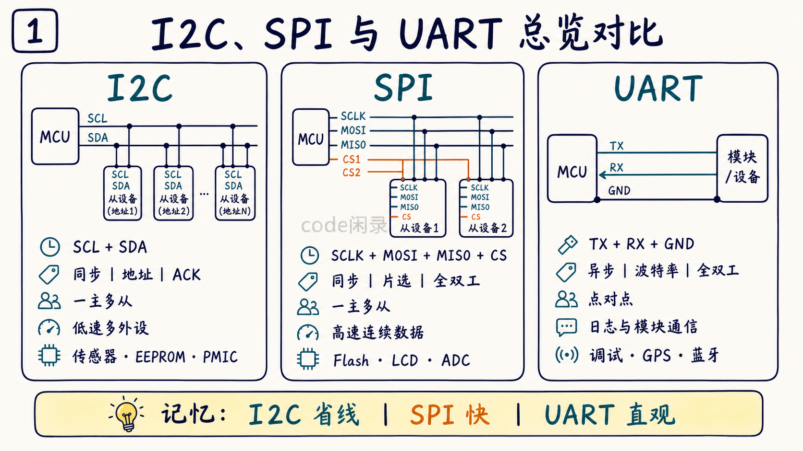
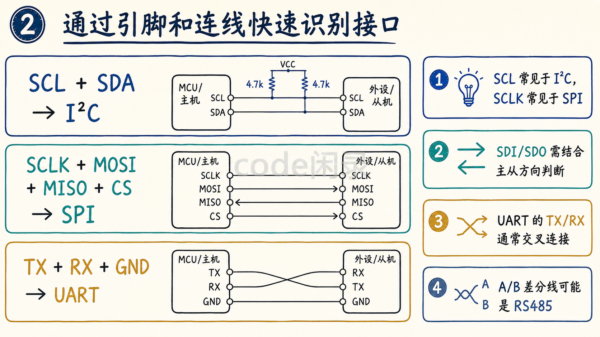
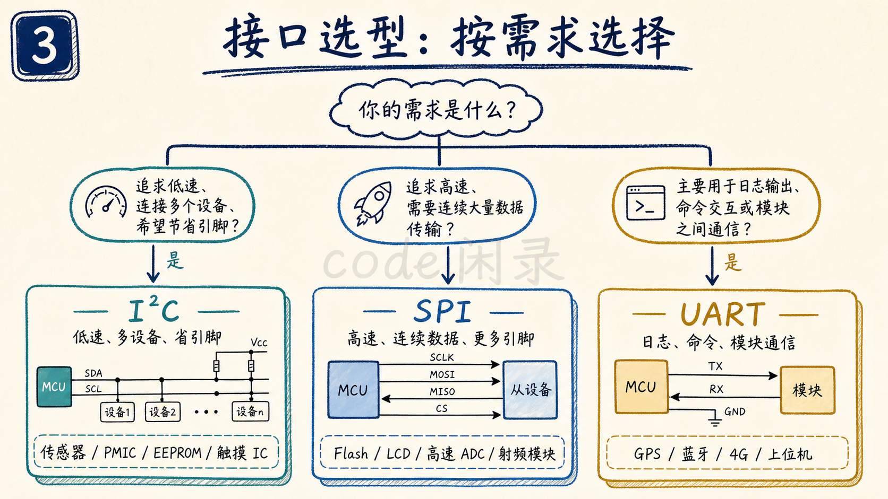
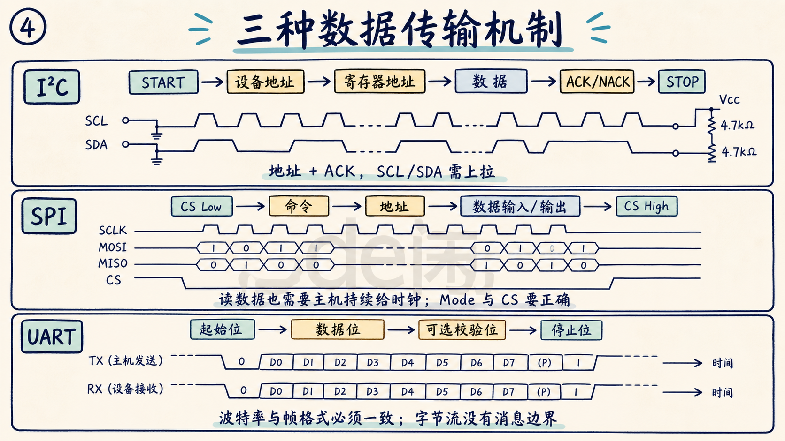
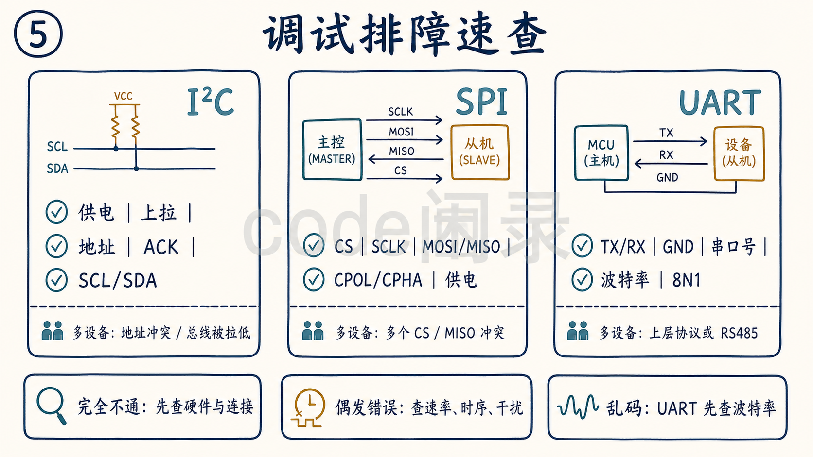
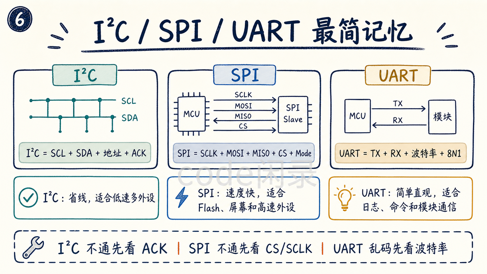

# I2C / SPI / UART 快速对比总结

> 目标：这篇文档用于快速分辨 I2C、SPI、UART 三种常见嵌入式通信接口。重点不是深入每个协议细节，而是帮助阅读者看到接口、连线、通信方式和典型用途时，能快速判断“这是什么协议、适合做什么、调试时先看哪里”。
>
> 来源：围绕上述几篇文章，让AI总结的差异点。



*图 1：I2C、SPI、UART 的连线、拓扑和典型用途总览。*

## 1. 一句话区分

- **I2C**：两根线、带地址、适合多个低速板级外设。
- **SPI**：线更多、速度快、靠片选选设备，适合高速外设和存储/显示。
- **UART**：异步串口、TX/RX 点对点常见，适合日志、命令和模块通信。

## 2. 大表格快速对比

| 对比项 | I2C | SPI | UART |
| --- | --- | --- | --- |
| 全称 | Inter-Integrated Circuit | Serial Peripheral Interface | Universal Asynchronous Receiver/Transmitter |
| 中文理解 | 芯片间两线串行总线 | 同步串行外设接口 | 通用异步串口 |
| 常见信号线 | `SCL`、`SDA` | `SCLK`、`MOSI`、`MISO`、`CS` | `TX`、`RX`、`GND` |
| 最少数据/控制线 | 2 根信号线 | 通常 4 根信号线 | 通常 2 根信号线加共地 |
| 是否需要时钟线 | 需要，`SCL` | 需要，`SCLK` | 不需要单独时钟线 |
| 时钟来源 | 主机提供 | 主机提供 | 双方靠约定波特率 |
| 通信方式 | 同步通信 | 同步通信 | 异步通信 |
| 常见拓扑 | 一主多从常见 | 一主多从常见 | 点对点常见 |
| 从设备选择方式 | 设备地址 | 片选 `CS` | 通常没有总线地址 |
| 是否支持多设备 | 支持，但地址不能冲突 | 支持，但通常每个从设备要独立片选 | 原生点对点，多设备要靠协议或 RS485 等扩展 |
| 数据方向 | 半双工常见 | 全双工常见 | 全双工常见 |
| 是否有 ACK | 有，每字节后有 ACK/NACK | 标准 SPI 没有统一 ACK | 底层没有统一 ACK |
| 常见速度 | 100 kHz、400 kHz、1 MHz | 几 MHz 到几十 MHz 常见 | 9600、115200、921600 等 |
| 速度特点 | 较低，适合控制和配置 | 较高，适合连续数据 | 中低速到较高速，取决于波特率 |
| 硬件复杂度 | 线少，但需要上拉 | 线多，但时序直接 | 线少，参数必须匹配 |
| 是否需要上拉 | 通常需要上拉电阻 | 通常不需要 I2C 那种上拉 | TTL UART 通常不需要专门上拉 |
| 空闲状态特点 | SCL/SDA 通常被上拉为高 | 由 SPI Mode 决定 SCLK 空闲电平 | TX/RX 空闲通常为高 |
| 关键配置 | 地址、速率、上拉、寄存器读写流程 | CPOL、CPHA、CS、速率、命令格式 | 波特率、数据位、校验位、停止位 |
| 典型配置写法 | 7 位地址，如 `0x50` | Mode 0/1/2/3，频率，如 10 MHz | `115200 8N1` |
| 常见设备 | 传感器、PMIC、EEPROM、触摸 IC | SPI Flash、LCD、ADC、无线模块 | 调试串口、GPS、蓝牙、4G、AT 模块 |
| 典型优势 | 省引脚、可挂多个低速设备 | 速度快、协议简单、全双工 | 简单直观、调试方便、不用时钟线 |
| 典型缺点 | 速度低、地址可能冲突、依赖上拉 | 线多、片选多、无统一 ACK | 参数不一致会乱码、点对点为主 |
| 最常见错误 | 7 位/8 位地址混用，没有 ACK | CPOL/CPHA 错、MOSI/MISO 接反、CS 错 | TX/RX 没交叉、波特率不一致、没共地 |
| 不通先看什么 | 供电、上拉、地址、ACK、SCL/SDA | 供电、CS、SCLK、SPI Mode、MOSI/MISO | TX/RX、GND、波特率、8N1、串口号 |
| 适合一句话 | 低速多外设、省引脚 | 高速外设、存储、显示 | 日志调试、命令交互、模块通信 |

## 3. 看到引脚名怎么快速判断

| 看到的引脚 | 大概率是什么 |
| --- | --- |
| `SCL`、`SDA` | I2C |
| `IIC_SCL`、`IIC_SDA` | I2C |
| `SCLK`、`MOSI`、`MISO`、`CS` | SPI |
| `CLK`、`DIN`、`DOUT`、`CS` | SPI，具体看芯片手册 |
| `TX`、`RX` | UART |
| `UART_TX`、`UART_RX` | UART |
| `A`、`B` 差分线 | 可能是 RS485，需要结合 UART/收发器看 |

注意：

- `SCL` 更常用于 I2C。
- `SCLK` 更常用于 SPI。
- 有些芯片把 `MOSI/MISO` 写成 `SDI/SDO`，要站在主机还是从机角度看方向。
- UART 的 `TX/RX` 接线通常要交叉。



*图 2：从常见引脚名和接线方式快速判断接口类型。*

## 4. 怎么选择

### 4.1 选 I2C 的情况

适合：

- 外设速度要求不高。
- 板上有多个低速器件。
- 希望节省引脚。
- 主要做寄存器配置和少量数据读取。

典型例子：

- 温湿度传感器。
- 光感。
- PMIC。
- EEPROM。
- 触摸 IC 配置。

一句话：

> 低速、多设备、省引脚，优先想到 I2C。

### 4.2 选 SPI 的情况

适合：

- 数据量更大。
- 速度要求更高。
- 外设需要连续读写。
- 能接受更多引脚。

典型例子：

- SPI Flash。
- LCD/OLED。
- 高速 ADC。
- 射频模块。
- 需要较高吞吐的传感器。

一句话：

> 高速、连续数据、存储或显示，优先想到 SPI。

### 4.3 选 UART 的情况

适合：

- 调试日志输出。
- 命令行交互。
- 模块之间点对点通信。
- 设备提供 AT 指令或串口协议。

典型例子：

- 系统启动日志。
- GPS 模块。
- 蓝牙模块。
- 4G 模块。
- MCU 和上位机通信。

一句话：

> 日志、命令、模块通信，优先想到 UART。



*图 3：按速度、设备数量、引脚资源和用途选择合适接口。*

## 5. 三者的典型数据传输理解

### 5.1 I2C 像“带地址的低速公共总线”

I2C 总线上可以挂多个设备，主机通过地址找到目标从设备。

```text
START -> 设备地址 -> 寄存器地址 -> 数据 -> ACK/NACK -> STOP
```

重点：

- 地址不能错。
- 每个字节后有 ACK/NACK。
- SCL/SDA 需要上拉。

### 5.2 SPI 像“片选点名后的高速移位”

SPI 主机先拉低某个从设备的片选，再一边输出时钟，一边移入移出数据。

```text
CS Low -> 命令 -> 地址 -> 数据输入/输出 -> CS High
```

重点：

- 片选要对。
- Mode 要对。
- 读数据也要主机继续给时钟。

### 5.3 UART 像“双方约好速度后的字节流”

UART 不需要时钟线，双方提前约好波特率和帧格式。

```text
起始位 -> 数据位 -> 可选校验位 -> 停止位
```

重点：

- TX/RX 要交叉。
- 波特率和 8N1 等参数要一致。
- 底层只传字节流，不知道消息边界。



*图 4：三种接口的数据帧与关键时序要点。*

## 6. 调试时的第一反应

| 现象 | I2C 优先看 | SPI 优先看 | UART 优先看 |
| --- | --- | --- | --- |
| 完全不通 | 供电、上拉、地址、ACK | CS、SCLK、MOSI/MISO、Mode | TX/RX、GND、串口号、波特率 |
| 读到全 0 或全 FF | 地址、上拉、寄存器流程 | MISO、CS、命令、dummy cycle | 通常不像 UART 典型现象，先看解析 |
| 偶发错误 | 上拉、电容、速率、干扰 | 速率、采样边沿、布线、电源 | 波特率误差、线长、干扰、缓冲溢出 |
| 乱码 | 一般不是 I2C 典型说法 | 一般看模式/字节序 | 波特率、数据位、校验位、停止位 |
| 多设备冲突 | 地址冲突、总线被拉低 | 多个 CS 同时有效、MISO 冲突 | 原生不适合多点，需上层协议或 RS485 |



*图 5：通信异常时三种接口的优先检查项。*

## 7. 面试常见对比回答

### 7.1 I2C、SPI、UART 最大区别是什么

> I2C 是两线同步总线，通过设备地址访问多个低速外设；SPI 是同步串行接口，通过片选选择从设备，速度更高，常用于 Flash、屏幕等；UART 是异步串口，不需要时钟线，双方靠相同波特率通信，常用于调试日志和模块通信。

### 7.2 为什么 I2C 线少但速度低

> I2C 只有 SCL 和 SDA 两根线，还能挂多个设备，优点是省引脚；但它依赖开漏和上拉电阻，边沿速度受限，每字节还有 ACK 等开销，所以速度通常不如 SPI。

### 7.3 为什么 SPI 速度快但线多

> SPI 由主机直接提供时钟，通过 MOSI/MISO 同时收发，并用片选选择从设备，没有地址和 ACK 开销，所以速度快。但它通常需要 SCLK、MOSI、MISO、CS，多从设备还要更多片选线。

### 7.4 为什么 UART 不需要时钟线

> UART 是异步通信，双方提前约定波特率和帧格式。接收方通过起始位同步一帧开始，然后按约定速度采样，所以不需要单独时钟线。

### 7.5 项目里怎么快速判断用哪个接口

> 看引脚和用途。SCL/SDA 基本是 I2C，适合低速配置类外设；SCLK/MOSI/MISO/CS 基本是 SPI，适合高速外设；TX/RX 基本是 UART，常用于日志、命令或模块通信。

## 8. 最简记忆版

只想快速记住，可以背下面几句：

- `I2C = SCL + SDA + 地址 + ACK`。
- `SPI = SCLK + MOSI + MISO + CS + Mode`。
- `UART = TX + RX + 波特率 + 8N1`。
- I2C 省线，适合低速多外设。
- SPI 速度快，适合 Flash、屏幕和高速外设。
- UART 简单直观，适合日志、命令和模块通信。
- I2C 不通先看 ACK，SPI 不通先看 CS/SCLK，UART 乱码先看波特率。



*图 6：接口识别、选型和排障的一页速记。*
