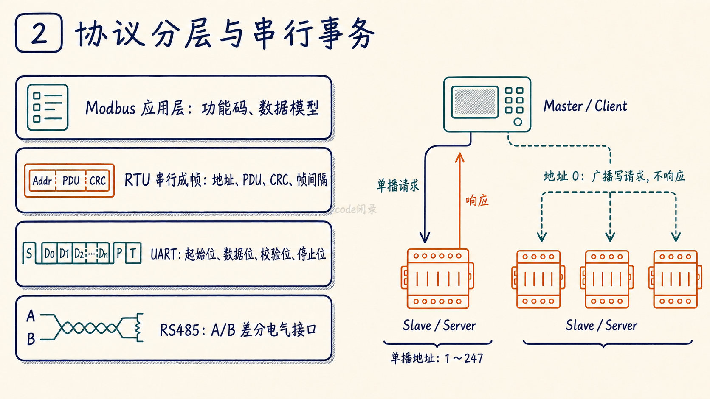
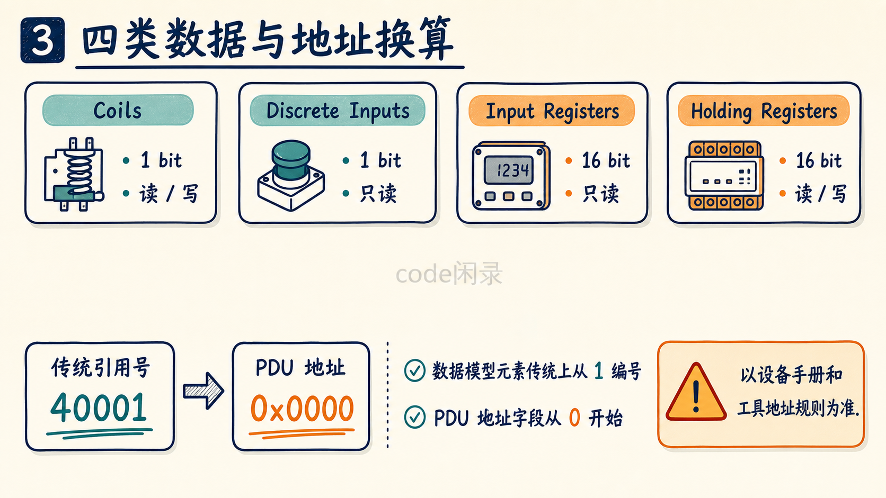
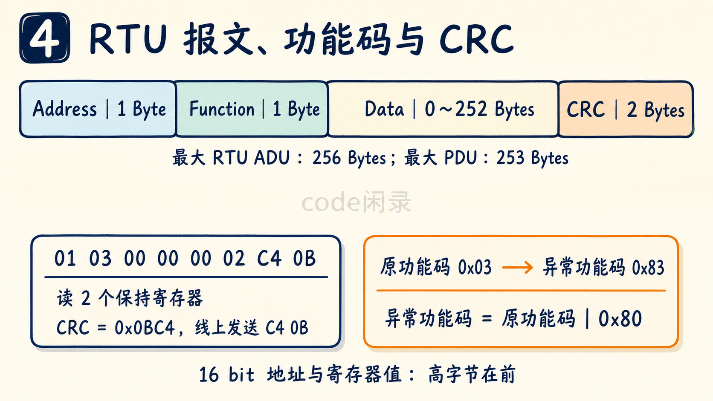
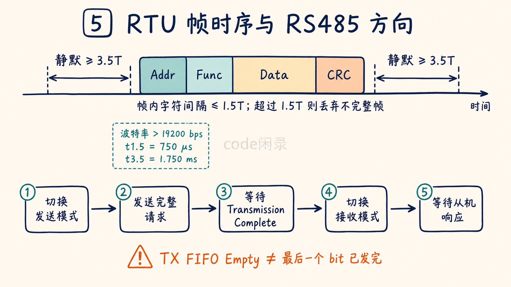
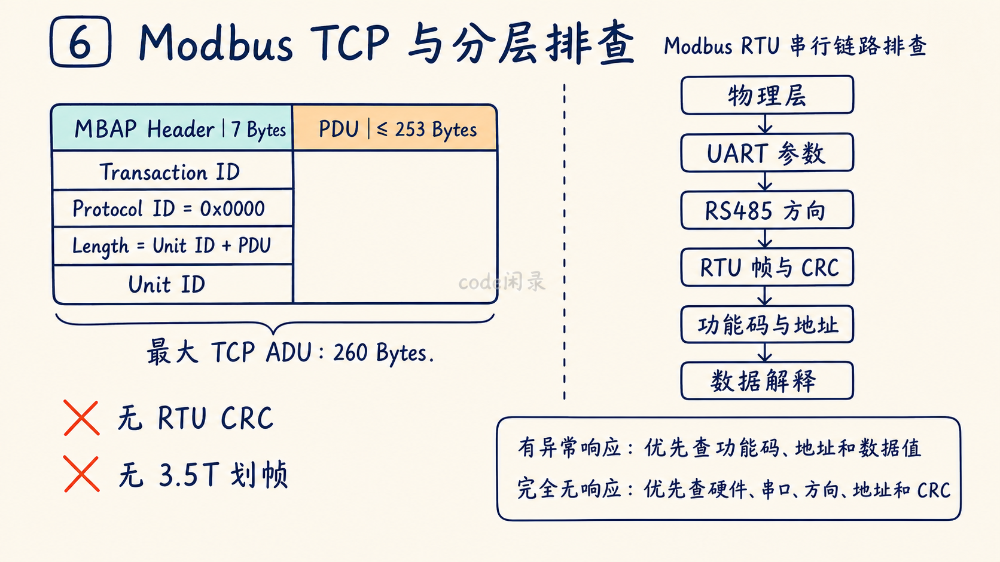

# Modbus 基础知识总结

> 目标：这篇文档只作为 Modbus 入门、嵌入式开发和项目面试复习使用，不展开复杂的工业自动化网络架构、PLC 编程和厂商私有扩展。重点记住：Modbus 是什么、Modbus 和 RS485 是什么关系、主从通信怎么工作、四类数据模型、常用功能码、RTU 帧格式、CRC、寄存器地址、异常响应，以及通信不通时怎么排查。
>
> 来源与校验：本文以 Modbus Organization 官方《[MODBUS Application Protocol Specification V1.1b3](https://www.modbus.org/file/secure/modbusprotocolspecification.pdf)》《[MODBUS over Serial Line Specification and Implementation Guide V1.02](https://www.modbus.org/file/secure/modbusoverserial.pdf)》《[MODBUS Messaging on TCP/IP Implementation Guide V1.0b](https://www.modbus.org/file/secure/messagingimplementationguide.pdf)》为主要依据，并对 RTU 帧长度、地址范围、广播规则、功能码、数据编码、CRC 字节顺序、RTU 帧间隔和 TCP MBAP 结构进行了交叉校验。重点面向实际嵌入式项目中最常见的 Modbus RTU + RS485 场景。


*图 1：全文七章结构总览。*

## 第一章、协议定位与应用场景

### 1.1、协议定义与核心特征

**Modbus 是一种基于请求 / 响应模型的工业通信应用层协议，常用于 PLC、传感器、仪表、变频器、网关等设备之间交换离散量和寄存器数据。**

它最典型的特点是：

- 协议本身定义的是应用层数据格式和功能码，不等同于 RS485。
- 串行 Modbus 最常见的是 `Modbus RTU + RS485`。
- 串行链路上通常由一个 Master 主动发起请求，Slave 根据地址响应。
- 数据主要抽象成 Coil、Discrete Input、Input Register、Holding Register 四类。
- 通过功能码表示“读什么、写什么、怎么操作”。
- Modbus RTU 使用 `CRC-16` 校验一帧数据。
- Modbus TCP 则把 Modbus PDU 放到 TCP/IP 网络中传输。

常见用途：

| 用途 | 常见场景 |
| --- | --- |
| PLC 与现场设备 | PLC、远程 IO、仪表、传感器 |
| 电机控制 | 变频器、伺服驱动器、电机控制器 |
| 能源设备 | 电表、逆变器、充电设备、BMS |
| 环境监测 | 温湿度、压力、流量、气体传感器 |
| 楼宇和工业控制 | 空调、新风、照明、门禁、网关 |

简单记法：

- `Master / Client`：主动发起请求的一方。
- `Slave / Server`：接收请求并返回结果的一方。
- `Address`：串行 Modbus 中的从站地址。
- `Function Code`：表示具体操作类型。
- `Register`：Modbus 中常见的 16 bit 数据单元。
- `RTU`：最常见的串行二进制 Modbus 格式。
- `TCP`：运行在 TCP/IP 上的 Modbus 形式。

### 1.2、嵌入式数据交换流程

Modbus 的核心作用不是“传任意字节流”，而是用一套统一的读写模型，让不同设备之间按照约定访问数据。

以一个主控制器读取温湿度传感器为例，可以理解为：

1. 主机知道传感器的 Modbus 从站地址，例如 `0x01`。
2. 主机查设备协议表，知道温度存放在某个 Input Register 或 Holding Register。
3. 主机使用对应功能码构造请求。
4. 如果是 Modbus RTU，还要加从站地址和 CRC。
5. 从机收到报文后检查地址、功能码、数据和 CRC。
6. 从机读取内部变量，并按照 Modbus 格式返回。
7. 主机解析返回的数据，再根据厂商规定的缩放系数换算成实际温度。

例如：

```text
MCU / PLC
   |
   |  读取从站 1 的寄存器
   v
Modbus Master
   |
   |  Modbus RTU
   v
RS485 Transceiver
   |
   |  A / B 差分总线
   v
Sensor / Meter / Drive
```

也就是说：

- Modbus 规定“请求和响应怎么组织”。
- RS485 负责“电信号怎么在线上传输”。
- UART 负责“字节怎么串行收发”。
- 具体寄存器代表什么，则由设备厂商协议表定义。

这一层次关系非常重要，后面很多问题都是因为把这几个概念混成了同一个东西。

### 1.3、Modbus、UART 与 RS485 的分层关系

最容易出现的错误说法就是：

> Modbus 就是 RS485。

这不准确。

更准确地说：

- `Modbus`：应用层协议。
- `RS485`：物理层 / 电气接口标准。
- `UART`：MCU 内部常用的串行通信外设。
- `Modbus RTU over RS485`：实际工程中非常常见的一种组合。

可以粗略理解为：

```text
┌─────────────────────────────┐
│ Modbus Application Protocol │  功能码、寄存器、请求/响应
├─────────────────────────────┤
│ Modbus RTU Framing          │  串行地址、PDU、CRC、帧间隔
├─────────────────────────────┤
│ UART                        │  起始位、数据位、校验位、停止位
├─────────────────────────────┤
│ RS485                       │  差分电气信号、A/B 总线
└─────────────────────────────┘
```

所以：

> RS485 上可以跑 Modbus，也可以跑自定义协议；Modbus 也不只能跑在 RS485 上，它还可以运行在 RS232、TCP/IP 等网络上。

### 1.4、Modbus RTU、ASCII 与 TCP

常见 Modbus 形式：

| 类型 | 传输介质 | 特点 |
| --- | --- | --- |
| `Modbus RTU` | 常见 RS485 / RS232 | 二进制编码，效率高，使用 CRC |
| `Modbus ASCII` | 串口 | ASCII 编码，效率较低，使用 LRC |
| `Modbus TCP` | Ethernet + TCP/IP | 使用 MBAP Header，不使用 RTU CRC |

实际嵌入式设备中最常见的是：

```text
Modbus RTU + RS485
```

因此本文后面主要围绕这一组合展开。

## 第二章、串行通信模型与设备地址

在 Modbus 串行线上，通常使用 Master / Slave 模型。

其基本规则是：

- Master 主动发起通信。
- Slave 通常不会主动发送数据。
- Slave 之间不会直接互相通信。
- Master 一次发起一个事务。
- 被点名的 Slave 处理请求并返回响应。

官方应用层文档现在更常使用：

```text
Client / Server
```

串行 Modbus 文档中则大量使用：

```text
Master / Slave
```

在串行 Modbus 中，可以简单对应为：

```text
Master ≈ Client
Slave  ≈ Server
```

### 2.1、从站地址范围

串行 Modbus 的地址空间是一个字节，共 `0 ~ 255`。

| 地址 | 含义 |
| --- | --- |
| `0` | 广播地址 |
| `1 ~ 247` | 合法的独立从站地址 |
| `248 ~ 255` | 保留 |

重点：

- 每个从站地址在同一条总线上必须唯一。
- Master 本身没有普通意义上的从站地址。
- 地址 `0` 不能作为普通单播从站地址使用。

### 2.2、广播事务

当 Master 使用地址 `0` 发送广播时：

- 所有从站都应该识别这个广播地址。
- 广播请求用于写操作。
- 从站执行广播写操作后**不能返回响应**。
- Master 发送广播后不能傻等响应，而应该等待合理的 turnaround delay 后再进行下一次通信。

直白说法：

> 地址 0 相当于“所有人都执行这条写命令”，但谁都不允许回话，否则总线上几十个设备一起抢着回答，人类又发明了一种新的噪声源。



*图 2：Modbus、RTU、UART 与 RS485 的分层关系，以及单播和广播事务。*

## 第三章、数据模型与寄存器寻址

Modbus 最核心的抽象不是“内存地址”，而是四类逻辑数据表。

| 数据类型 | 数据宽度 | 典型访问属性 | 常见叫法 |
| --- | --- | --- | --- |
| `Coils` | 1 bit | 读 / 写 | 线圈 |
| `Discrete Inputs` | 1 bit | 只读 | 离散输入 |
| `Input Registers` | 16 bit | 只读 | 输入寄存器 |
| `Holding Registers` | 16 bit | 读 / 写 | 保持寄存器 |

典型理解：

- `Coil`：一个可读写的开关量，例如继电器开关。
- `Discrete Input`：一个只读输入状态，例如外部数字输入。
- `Input Register`：一个只读 16 位数值，例如测量值。
- `Holding Register`：一个可读写 16 位数值，例如配置参数。

需要注意：

> 这是 Modbus 的逻辑数据模型，不代表设备内部真的必须有四块完全独立的物理内存。

厂商完全可以在内部把它们映射到 RAM、Flash、传感器值、设备状态或其他变量。

### 3.1、传统引用号与 PDU 地址偏移

很多设备手册会这样写：

| 传统表示 | 常见含义 |
| --- | --- |
| `00001` 开头 | Coil |
| `10001` 开头 | Discrete Input |
| `30001` 开头 | Input Register |
| `40001` 开头 | Holding Register |

但这里非常容易出坑。

例如文档写：

```text
Holding Register 40001
```

很多情况下，它对应协议 PDU 中实际发送的地址偏移是：

```text
0x0000
```

Modbus 数据模型中的元素传统上从 `1` 编号，而 PDU 中的地址字段从 `0` 开始。

因此：

```text
文档编号：40001
协议地址：0
```

但问题来了：

- 有些上位机软件要求输入 `40001`。
- 有些要求输入 `1`。
- 有些要求输入 `0`。
- 有些厂商手册直接写十六进制偏移地址。

所以不要靠猜。

直白说法：

> Modbus 最折磨人的往往不是 CRC，而是“文档写 40001，软件到底填 40001、1 还是 0”。协议本身并不迷糊，真正迷糊的是不同厂商几十年积累出来的地址表示习惯。



*图 3：四类逻辑数据表与传统引用号到 PDU 地址的换算。*

## 第四章、Modbus RTU 报文与功能码

Modbus RTU 一帧通常由四部分组成：

| 字段 | 长度 | 含义 |
| --- | --- | --- |
| `Slave Address` | 1 Byte | 从站地址 |
| `Function Code` | 1 Byte | 功能码 |
| `Data` | N Bytes | 地址、数量、数据等 |
| `CRC` | 2 Bytes | CRC-16 校验 |

可以表示成：

```text
┌─────────┬──────────┬──────────────┬─────────┐
│ Address │ Function │     Data     │   CRC   │
│ 1 Byte  │ 1 Byte   │ 0~252 Bytes │ 2 Bytes │
└─────────┴──────────┴──────────────┴─────────┘
```

Modbus RTU 最大 ADU 长度是：

```text
256 Bytes
```

其中最大 Modbus PDU 是：

```text
253 Bytes
```

### 4.1、读取保持寄存器示例

假设：

- 从站地址：`0x01`
- 功能码：`0x03`
- 起始地址：`0x0000`
- 读取数量：`0x0002`

请求：

```text
01 03 00 00 00 02 C4 0B
```

字段解释：

```text
01          从站地址
03          Read Holding Registers
00 00       起始地址 = 0
00 02       读取 2 个寄存器
C4 0B       CRC，低字节在前
```

如果两个寄存器内容分别是：

```text
Register 0 = 0x1234
Register 1 = 0x5678
```

正常响应可以表示为：

```text
01 03 04 12 34 56 78 CRC_L CRC_H
```

其中：

```text
01          从站地址
03          功能码
04          后续数据长度为 4 Byte
12 34       第一个寄存器
56 78       第二个寄存器
CRC_L/H     CRC
```

### 4.2、多字节数据顺序

官方 Modbus 应用层协议规定：

> 地址和数值字段中，大于 1 Byte 的数值按高字节在前发送。

例如：

```text
0x1234
```

线上发送顺序是：

```text
12 34
```

但 CRC 是一个特别容易把人坑进下午茶时间的例外：

```text
CRC Low Byte 先发送
CRC High Byte 后发送
```

因此不能简单地说：

> Modbus 所有多字节字段都是大端。

更准确的是：

- 地址、寄存器值、数量等协议数值字段：高字节在前。
- RTU CRC 两个字节：低字节在前。

另外：

> Modbus 规范定义了单个 16 bit Register 内部按高字节在前传输，但没有统一规定 32 bit 整数、float、double 跨多个寄存器时的寄存器先后顺序。

若两个寄存器依次包含 `0x1234` 和 `0x5678`，符合单寄存器编码规则的常见 32 bit 拼接结果有：

```text
0x12345678  // 高字寄存器在前
0x56781234  // 低字寄存器在前
```

部分工具还提供“寄存器内字节交换”选项，可能显示为 `BADC` 或 `DCBA`；这属于厂商实现或工具适配方式，不应误认为 Modbus 统一规定。具体必须看设备协议手册，并用已知测试值验证。

### 4.3、功能码与异常响应

功能码决定 Slave 应该执行什么操作。

最常用的功能码：

| 功能码 | 名称 | 作用 |
| --- | --- | --- |
| `0x01` | Read Coils | 读取线圈 |
| `0x02` | Read Discrete Inputs | 读取离散输入 |
| `0x03` | Read Holding Registers | 读取保持寄存器 |
| `0x04` | Read Input Registers | 读取输入寄存器 |
| `0x05` | Write Single Coil | 写单个线圈 |
| `0x06` | Write Single Register | 写单个保持寄存器 |
| `0x0F` | Write Multiple Coils | 写多个线圈 |
| `0x10` | Write Multiple Registers | 写多个保持寄存器 |

嵌入式项目中最常见的通常就是：

```text
01 / 02 / 03 / 04 / 05 / 06 / 0F / 10
```

#### 4.3.1、正常响应

正常情况下，Slave 返回的功能码与请求功能码相同。

例如：

```text
请求：01 03 ...
响应：01 03 ...
```

#### 4.3.2、异常响应

如果 Slave 收到发给本机且已通过串行帧边界、地址、奇偶校验和 CRC 等通信层检查的单播请求，但因功能码、数据地址、数据值或设备状态等原因无法执行，会返回异常响应。广播请求无论正常执行还是发生处理异常都不返回响应。

规则是：

```text
异常功能码 = 原功能码 | 0x80
```

例如：

```text
原功能码：0x03
异常响应功能码：0x83
```

后面再跟一个异常码。

常见异常码：

| 异常码 | 含义 |
| --- | --- |
| `0x01` | Illegal Function，功能码不支持 |
| `0x02` | Illegal Data Address，数据地址非法 |
| `0x03` | Illegal Data Value，数据值非法 |
| `0x04` | Server Device Failure，设备执行失败 |
| `0x05` | Acknowledge，请求已接受但需要较长时间 |
| `0x06` | Server Device Busy，设备忙 |
| `0x0A` | Gateway Path Unavailable，网关路径不可用 |
| `0x0B` | Gateway Target Device Failed to Respond，目标设备无响应 |

例如：

```text
01 83 02 CRC_L CRC_H
```

表示：

```text
从站 1
原请求功能码 03
异常响应功能码 83
异常码 02：地址非法
```

重点：

> “收到异常响应”和“完全没收到响应”是两类不同问题。

如果收到异常响应：

- 物理链路大概率已经通了。
- 波特率、从站地址、CRC 通常至少已经基本正确。
- 应重点检查功能码、寄存器地址、数量和设备状态。

如果完全没响应：

- 先从硬件、串口参数、485 方向、地址和 CRC 开始查。



*图 4：RTU ADU 结构、功能码异常响应和 CRC 发送顺序。*

## 第五章、CRC、帧边界与串口参数

### 5.1、CRC 校验

Modbus RTU 使用 CRC-16 对整帧内容进行错误检测。

CRC 计算范围包括：

```text
Slave Address + Function Code + Data
```

不包含：

```text
CRC 字段自身
```

常见实现参数可以理解为：

```text
CRC-16/MODBUS
Init = 0xFFFF
Polynomial = 0x8005   // 标准多项式
RefIn/RefOut = true
XorOut = 0x0000
0xA001                 // 按最低位优先移位时常用的反射实现值
```

最终 CRC 是 16 bit。

发送时：

```text
CRC Low Byte
CRC High Byte
```

例如前面的请求：

```text
01 03 00 00 00 02
```

计算得到：

```text
CRC = 0x0BC4
```

线上添加为：

```text
C4 0B
```

重点：

- CRC 算法算对，不代表发送顺序一定对。
- 很多 CRC 计算器显示的是 `0x0BC4`。
- 真正线上发送的是 `C4 0B`。

### 5.2、RTU 帧边界

Modbus RTU 没有固定的帧头字节和帧尾字节。

它主要依靠：

```text
总线静默时间
```

来判断帧边界。

关键时间：

```text
t1.5 = 1.5 个字符时间
t3.5 = 3.5 个字符时间
```

规则：

- 一帧开始前，应至少有 `3.5` 个字符时间的静默。
- 一帧结束后，也应至少有 `3.5` 个字符时间的静默。
- 一帧内部应该连续传输。
- 如果两个字符之间静默时间超过 `1.5` 个字符时间，接收端应认为这帧不完整并丢弃。

可以简单画成：

```text
静默 >= 3.5T
      |
      v
┌───────────────────────────────┐
│ Addr Func Data ... CRC_L CRC_H│
└───────────────────────────────┘
                               |
                               v
                         静默 >= 3.5T
```

官方串行实现指南还建议：

- 波特率 `<= 19200 bps` 时，严格按字符时间计算 `t1.5 / t3.5`。
- 波特率 `> 19200 bps` 时，可采用固定定时：
  - `t1.5 = 750 μs`
  - `t3.5 = 1.750 ms`

### 5.3、UART 参数

Modbus RTU 本质上仍依赖串口字节传输，因此双方必须配置一致：

- 波特率。
- 数据位。
- 校验位。
- 停止位。

官方串行指南定义 RTU 字符采用 8 个数据位，默认偶校验；使用校验时为 1 个停止位，使用无校验时应增加为 2 个停止位，以保持 11 bit 字符长度。

现实项目中也能见到厂商设备使用：

```text
9600 8N1
19200 8N1
115200 8N1
```

其中 `8N1` 不符合官方串行指南规定的 11-bit RTU 字符格式；无校验时标准格式为 `8N2`。部分厂商仍可能采用 `8N1` 私有配置，工程上应以设备协议手册为准，并明确区分“规范格式”和“厂商实际配置”。

## 第六章、Modbus TCP 封装

Modbus TCP 不是：

```text
把 Modbus RTU 帧原封不动塞进 TCP
```

更准确地说：

- Modbus 的 PDU 仍然保留。
- 串行 ADU 中的从站地址和 CRC 不再保留；TCP ADU 使用 MBAP Header，其中 Unit Identifier 可用于网关后的串行设备路由。
- TCP/IP 网络负责传输可靠性。
- 默认使用 TCP 端口 `502`。

Modbus TCP ADU：

```text
┌────────────────────┬────────────────────────┐
│ MBAP Header        │ Modbus PDU             │
│ 7 Bytes            │ Function + Data        │
└────────────────────┴────────────────────────┘
```

MBAP Header 主要包括：

| 字段 | 长度 | 作用 |
| --- | --- | --- |
| Transaction Identifier | 2 Byte | 匹配请求和响应 |
| Protocol Identifier | 2 Byte | Modbus 固定为 `0x0000`，接收端应校验该字段 |
| Length | 2 Byte | 后续字节数，即 `Unit Identifier + PDU` 的长度 |
| Unit Identifier | 1 Byte | 单元标识，主要用于经网关访问串行从站等场景 |

因此：

```text
Modbus RTU:
Address + PDU + CRC

Modbus TCP:
MBAP + PDU
```

重点：

- Modbus TCP 没有 RTU 的 CRC 字段。
- Modbus TCP 不依赖 3.5 字符时间来切帧。
- Modbus TCP 的寄存器模型、功能码和 PDU 思路与普通 Modbus 保持一致。
- Modbus TCP ADU 最大为 `260 Byte`：`7 Byte MBAP + 253 Byte PDU`。

## 第七章、驱动实现、故障排查与速查

做 Modbus RTU 驱动时，真正折磨人的通常不是“功能码表背不下来”，而是下面这些细节。

常见风险：

- **把 Modbus 和 RS485 当成同一个东西**：协议层次理解错。
- **从站地址配置错误**：请求发给了不存在的设备。
- **寄存器地址偏移错误**：典型 `40001 ↔ 0`、`1-based ↔ 0-based` 问题。
- **功能码使用错误**：把 Input Register 用 `0x03` 读，或把 Holding Register 用 `0x04` 读。
- **CRC 算错**：初值、多项式、输入范围错误。
- **CRC 字节顺序错误**：把 `CRC_H CRC_L` 发成了高字节在前。
- **RS485 差分线极性接错**：物理层直接不通；不同厂商对 A/B 标注可能相反，应按两端手册或收发器引脚定义核对极性。
- **485 收发方向控制错误**：DE/RE 切换太早或太晚。
- **发送完成判断错误**：UART FIFO 空了不代表最后一个停止位已经真正发完。
- **串口参数不一致**：波特率、校验位、停止位不同。
- **帧间隔不合理**：两帧黏在一起或一帧内部被切断。
- **接收缓冲区过小**：大批量读取时丢数据。
- **超时设置过短**：从机还没处理完，主机已经判定失败。
- **异常响应没有解析**：收到 `0x83` 却当成“乱码”。
- **多寄存器数据字序错误**：float / uint32 解析错。
- **广播后等待响应**：地址 0 本来就不应该有响应。
- **多主机同时挂在普通 Modbus RTU 总线上**：标准串行主从模型本身并不是随便多主抢总线的设计。

### 7.1、RS485 半双工方向切换

典型半双工 RS485：

```text
MCU UART TX/RX
      |
      v
RS485 Transceiver
   DE / RE
      |
      v
     A / B
```

发送流程通常是：

```text
1. 切换到发送模式
2. UART 发送完整 Modbus 请求
3. 等待 UART 真正发送完成
4. 切换回接收模式
5. 等待从机响应
```

如果第 3 步判断错：

- DE 拉低太早，会把最后几个 bit 或停止位截断。
- DE 拉低太晚，可能挡住从机开始返回的数据。

所以实际代码中要区分：

```text
TX FIFO Empty
```

和：

```text
Transmission Complete
```

后者才更接近“最后一个 bit 已经从引脚发出去”。



*图 5：RTU 帧间隔、字符间隔与半双工 RS485 方向切换。*

### 7.2、分层排查流程

排查建议不要一上来就怀疑 CRC 算法有玄学。

按：

```text
物理层
→ UART
→ RS485方向
→ RTU帧
→ Modbus协议
→ 数据解释
```

逐层看，效率高得多。

#### 7.2.1、确认 RS485 硬件

检查：

- 差分线极性是否接错；不要只凭 A/B 字母判断，应核对两端手册中的同相/反相端定义。
- 节点是否有合理的信号参考地。
- 485 芯片供电是否正常。
- DE / RE 引脚状态是否正确。
- 总线终端电阻是否正确。
- 偏置电阻是否合理。
- 总线拓扑、线缆和分支是否合理。

如果示波器看 A/B 完全没有差分变化：

优先怀疑：

- UART 没发。
- DE 没打开。
- 收发器未供电。
- GPIO 复用或串口配置错误。
- 485 芯片损坏。

#### 7.2.2、确认串口参数

检查双方是否完全一致：

```text
Baud Rate
Data Bits
Parity
Stop Bits
```

例如设备协议写：

```text
9600 8E1
```

你配置成：

```text
9600 8N1
```

虽然人眼看数字都差不多，设备当然不会因此产生同理心。

#### 7.2.3、检查主机发送的原始报文

建议抓取原始字节：

```text
01 03 00 00 00 02 C4 0B
```

逐字节检查：

1. 从站地址是否正确。
2. 功能码是否正确。
3. 起始寄存器地址是否正确。
4. 数量是否正确。
5. 多字节字段高低字节是否正确。
6. CRC 是否正确。
7. CRC 两个字节顺序是否正确。

可以使用：

- 串口助手。
- USB-RS485。
- 逻辑分析仪。
- 示波器。
- Modbus Poll / QModMaster / pymodbus 等工具。

#### 7.2.4、主机有发送但从机完全不响应

优先检查：

- 从站地址错。
- UART 参数不一致。
- RS485 差分线极性接错。
- DE/RE 控制错误。
- CRC 错。
- 帧间隔错误。
- 设备根本没工作。
- 请求用了广播地址 `0`。
- 从机收到的帧因为校验错误直接被丢弃。

特别注意：

> 对于 CRC、奇偶校验、RTU 帧边界或从站地址不匹配等通信层错误，从站通常静默丢弃；若通信层检查通过，但功能码、数据地址或请求数据值不合法，发给本机的单播请求应返回相应异常响应，广播仍不响应。

若单播请求已通过从站地址、帧边界和 CRC 等通信层检查，但设备不支持请求的功能码，应返回异常码 `0x01`，而不是静默。广播请求即使发生处理异常也不得返回异常响应。

#### 7.2.5、收到异常响应

如果收到：

```text
01 83 02 ...
```

说明：

- 从机地址对了。
- 从机确实收到了请求。
- CRC 大概率也已经通过。
- 从机认为功能码 `0x03` 的请求地址不合法。

此时不要继续拿示波器量半小时。

应该查：

- 寄存器地址。
- 地址偏移。
- 读取数量。
- 功能码是否对应正确寄存器类型。
- 设备当前工作模式是否允许访问。

#### 7.2.6、收到数据但数值不正确

优先检查：

- 16 bit 有符号 / 无符号是否正确。
- 缩放系数是否正确。
- 单位是否正确。
- 高低字节是否正确。
- 32 bit 数据的寄存器顺序是否正确。
- IEEE754 float 字序是否正确。
- 设备协议版本是否一致。

例如两个寄存器：

```text
12 34 56 78
```

设备可能定义：

```text
0x12345678
```

也可能定义成：

```text
0x56781234
```

Modbus 并不会替厂商决定跨寄存器的 32 bit 排列。



*图 6：Modbus TCP 的 MBAP 封装与从物理层到数据解释的排查路径。*

### 7.3、面试与知识速查

**Modbus 是什么？**

> Modbus 是一种工业领域常用的应用层通信协议，采用请求 / 响应模型，通过功能码访问线圈、离散输入、输入寄存器和保持寄存器。实际嵌入式项目中常见 Modbus RTU 跑在 RS485 上。

**Modbus 和 RS485 有什么区别？**

> RS485 主要规定差分电气接口，Modbus 规定应用层的数据模型、功能码和请求响应格式。RS485 可以跑 Modbus，也可以跑其他协议；Modbus 也可以运行在 RS232 或 TCP/IP 上。

**Modbus RTU 一帧是什么格式？**

> Modbus RTU 一帧通常由从站地址、功能码、数据和 2 字节 CRC 组成，最大 RTU ADU 为 256 字节。CRC 低字节先发送，高字节后发送。

**Modbus 为什么需要从站地址？**

> 串行 Modbus 通常是一主多从，多台设备共用一条总线。Master 通过地址指定具体 Slave，地址 1 到 247 用于独立从站，0 是广播地址。

**地址 0 有什么特殊？**

> 地址 0 是广播地址。Master 可以用它向所有 Slave 发送广播写请求，Slave 执行后不返回响应，因此 Master 不能等待广播响应。

**四类 Modbus 数据是什么？**

> Coil 和 Discrete Input 是 1 bit 数据，其中 Coil 通常可读写，Discrete Input 通常只读；Input Register 和 Holding Register 是 16 bit 数据，其中 Input Register 通常只读，Holding Register 通常可读写。

**功能码 03 和 04 有什么区别？**

> 0x03 用于读取 Holding Registers，0x04 用于读取 Input Registers。两者响应格式比较接近，但访问的是不同逻辑数据表。

**为什么文档写 40001，程序却可能要填 0？**

> 40001 是传统寄存器引用表示法，而 Modbus PDU 中的逻辑地址从 0 开始。很多设备的 40001 对应协议地址 0，但不同厂商软件可能使用 0-based 或 1-based 显示，所以必须确认手册和工具的地址规则。

**Modbus RTU 如何判断一帧结束？**

> RTU 主要依靠静默时间划分帧边界。帧之间至少需要 3.5 个字符时间的静默，帧内部字符间隔如果超过 1.5 个字符时间，接收端应把该帧视为不完整。

**Modbus RTU 为什么需要 CRC？**

> CRC 用于检测一整帧传输过程中是否发生错误。它覆盖地址、功能码和数据字段，接收端重新计算并比较。RTU CRC 是 16 bit，线上低字节先发送。

**收到 0x83 是什么意思？**

> 0x83 表示原功能码 0x03 发生异常，因为 Modbus 异常响应会把原功能码最高位置 1，也就是原功能码加 0x80。后面的异常码才表示具体原因，例如 0x02 表示数据地址非法。

**Modbus TCP 和 Modbus RTU 有什么区别？**

> 两者共享 Modbus PDU 和功能码模型，但封装方式不同。RTU 使用从站地址和 CRC，并依赖串口帧间隔；TCP 使用 7 字节 MBAP Header，通过 TCP/IP 传输，默认端口 502，不使用 RTU CRC。

**Modbus 收不到数据怎么排查？**

> 先查 RS485 A/B、收发器供电和 DE/RE，再查 UART 波特率、校验位和停止位，然后抓原始帧检查从站地址、功能码、寄存器地址、CRC 和帧间隔。如果收到异常响应，则重点转向协议地址和功能码，而不是继续怀疑物理层。

### 7.4、高频易错点

| 错误说法 | 更准确的说法 |
| --- | --- |
| Modbus 就是 RS485 | Modbus 是应用层协议，RS485 是常见物理层 |
| Modbus RTU 只能用 RS485 | RTU 也可运行在 RS232 等串行链路上 |
| RS485 自带 Modbus 地址 | 地址属于 Modbus 串行协议，不属于 RS485 |
| Modbus 是多主协议 | 标准 Modbus Serial Line 是典型单主多从模型 |
| 地址 0 是普通从机 | 地址 0 是广播地址 |
| 广播请求也会有响应 | 广播写请求不返回响应 |
| 40001 就是线上发送的 40001 | 传统引用号和 PDU 实际地址不是一回事 |
| Holding Register 一定对应设备 RAM | 它只是协议逻辑数据模型 |
| 所有 Modbus 寄存器都是 32 bit | 一个 Register 是 16 bit |
| Modbus 所有多字节内容都是大端 | 协议数值字段高字节在前，但 RTU CRC 低字节先发 |
| Modbus 规定了 float 的统一字序 | 规范没有统一规定跨寄存器的 32 bit / float 寄存器顺序 |
| CRC 正确就一定能通信 | 还要地址、功能码、UART 参数、帧间隔和 485 方向都正确 |
| 功能码不支持时从机会静默 | 对合法单播请求，应返回异常码 `0x01`；广播请求始终不响应 |
| 没响应就一定是寄存器地址错 | CRC、地址、串口参数、485 方向等错误也会直接无响应 |
| 功能码 03 和 04 完全一样 | 03 读 Holding Register，04 读 Input Register |
| UART FIFO 空就能立刻关闭 485 DE | 应确认最后一个 bit 真正发送完成 |
| Modbus TCP 就是 RTU 帧加 TCP 头 | TCP 使用 MBAP + PDU，不保留 RTU CRC |
| Modbus TCP 也需要 3.5 字符间隔 | TCP 不依赖 RTU 的字符静默间隔划帧 |

### 7.5、最简记忆版

只想快速记住，可以背下面几句：

- Modbus 是应用层协议，RS485 是物理层，两者不是一个东西。
- 嵌入式项目中最常见组合是 `Modbus RTU + RS485`。
- 串行 Modbus 通常是一主多从，Master 主动请求，Slave 被动响应。
- 从站地址 `1 ~ 247`，地址 `0` 是广播，`248 ~ 255` 保留。
- 广播用于写请求，从站执行后不响应。
- Modbus 有四类数据：Coil、Discrete Input、Input Register、Holding Register。
- Coil 和 Discrete Input 是 1 bit；Input Register 和 Holding Register 是 16 bit。
- 最常见功能码是 `01、02、03、04、05、06、0F、10`。
- Modbus RTU 帧是 `Address + Function + Data + CRC`。
- RTU 最大帧长度是 `256 Byte`，最大 PDU 是 `253 Byte`。
- 地址、数量、16 bit Register 等数值字段通常高字节先发。
- RTU CRC 是 16 bit，但线上是 `CRC Low` 先发、`CRC High` 后发。
- RTU 帧之间至少需要 `3.5` 个字符时间静默。
- 一帧内部字符间隔超过 `1.5` 个字符时间，接收端应认为帧不完整。
- 文档里的 `40001` 不一定等于程序里填的 `40001`，一定确认 0-based / 1-based。
- 32 bit 整数和 float 的跨寄存器顺序不是 Modbus 统一规定的；单个 16 bit 寄存器仍按高字节在前传输。
- 异常响应功能码 = 原功能码 `| 0x80`。
- 收到异常响应优先查功能码和地址；完全没响应优先查硬件、UART、485 方向、地址和 CRC。
- Modbus TCP 使用 `MBAP + PDU`，默认 TCP 端口 `502`，不使用 RTU CRC。
