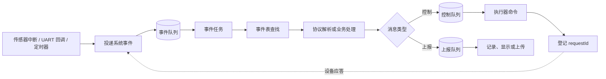

# 嵌入式 事件驱动模型

> 核心原则：**将系统行为建模为"事件→处理"的响应链；事件的生产者不关心谁来消费，消费者不关心事件从哪来，两者通过事件总线或队列解耦。**
>
> 背景：在嵌入式项目里，按键、传感器数据就绪、定时器超时、通信接收完成等都是天然的事件源。事件驱动模型能让模块间耦合降到最低，增减功能不影响已有逻辑。

## 1. 核心思想

事件驱动模型的核心是把"发生了什么"和"要做什么"分开。系统运行时，各模块向事件中心投递事件，已注册的处理器根据事件类型做出反应。

```text
传感器 → 按键 → 定时器 → 通信接收 → ...
          ↓
      事件队列 / 事件总线
          ↓
   处理器A  处理器B  处理器C
  （电机）  （日志）  （显示）
```

这种方式下，新增一个"收到数据后亮灯"的需求，只需新增一个事件处理器，无需改动传感器或通信模块的代码。

## 2. 轮询 vs 中断 vs 事件驱动

三种模型在嵌入式中的对比：

| 模型 | 原理 | 优点 | 缺点 |
|------|------|------|------|
| 轮询 | 主循环不断检查各模块状态 | 简单、确定性强 | 空转浪费 CPU，响应不及时 |
| 中断 | 硬件触发 ISR，直接处理 | 响应最快 | ISR 内不宜做复杂操作，嵌套复杂 |
| 事件驱动 | 中断/任务产生事件，由调度层分发 | 解耦好、可扩展 | 引入队列开销，事件顺序需关注 |

实际项目中通常是混合使用：中断捕获硬件信号后只投递事件，由任务级的事件循环统一处理：

```c
// ISR 中：只投递事件，不处理业务
void button_isr(void)
{
    event_t evt = { .type = EVENT_BUTTON_PRESS, .data = BUTTON_ID_A };
    event_queue_push(&g_event_queue, &evt);
}

// 任务中：消费事件，执行业务
void event_handler_task(void)
{
    event_t evt;
    while (1) {
        if (event_queue_pop(&g_event_queue, &evt, portMAX_DELAY)) {
            dispatch_event(&evt);
        }
    }
}
```

## 3. 事件驱动的基本要素

一个最小的事件驱动框架需要三个部分：

```c
// 1. 事件定义
typedef enum {
    EVENT_NONE = 0,
    EVENT_BUTTON_PRESS,
    EVENT_BUTTON_RELEASE,
    EVENT_SENSOR_DATA_READY,
    EVENT_TIMER_TIMEOUT,
    EVENT_UART_RX_DONE,
    EVENT_COUNT
} event_type_t;

typedef struct {
    event_type_t type;
    void       *data;
    uint32_t    data_len;
    uint32_t    timestamp;
} event_t;

// 2. 处理器注册表
typedef void (*event_handler_t)(const event_t *evt);

typedef struct {
    event_type_t    type;
    event_handler_t handler;
} event_subscription_t;

// 3. 分发函数
void dispatch_event(const event_t *evt)
{
    for (int i = 0; i < g_subscription_count; i++) {
        if (g_subscriptions[i].type == evt->type) {
            g_subscriptions[i].handler(evt);
        }
    }
}
```

一个事件可以被多个处理器订阅（比如按键事件同时触发电机动作和日志记录），也可以先到先处理（通过队列保证顺序）。

## 4. C 语言中的实用做法

- 事件类型用枚举集中管理，新增事件只需加一个枚举值。
- 事件数据用 `void *` 保持通用；约定好每个事件类型对应的数据结构，用 `data_len` 校验。
- 队列优先用 FreeRTOS 的 `xQueue` 或自己实现的环形缓冲，保证 ISR 和任务间的安全传递。
- 处理器注册用静态数组或链表；静态数组简单且确定性强，链表灵活但需要管理内存。
- 可以在事件中带上时间戳，方便做按键消抖、超时判断等。

一个带多订阅者的完整例子：

```c
// 处理器
static void motor_on_button(const event_t *evt) { motor_start(); }
static void led_blink_on_button(const event_t *evt) { led_blink(3, 200); }
static void log_on_button(const event_t *evt) { log_write("button pressed"); }

// 注册
static const event_subscription_t g_subscriptions[] = {
    { EVENT_BUTTON_PRESS, motor_on_button },
    { EVENT_BUTTON_PRESS, led_blink_on_button },
    { EVENT_BUTTON_PRESS, log_on_button },
};
```

新增需求（比如按键时也上报云端）只需加一行注册，不影响 `motor_on_button`、`led_blink_on_button`、`log_on_button` 和按键 ISR 的任何代码。

## 5. 对比例子：传感器数据处理

需求：温度传感器每 1 秒更新数据。超过 60°C 时开风扇并记录日志，低于 55°C 时关风扇。

**传统轮询写法**把所有逻辑揉在主循环里：

```c
void main_loop(void)
{
    while (1) {
        float temp = sensor_read_temperature();

        if (temp >= 60.0f && !g_fan_on) {
            fan_on();
            g_fan_on = true;
            log_write("fan on, temp=%.1f", temp);
        }
        if (temp <= 55.0f && g_fan_on) {
            fan_off();
            g_fan_on = false;
            log_write("fan off, temp=%.1f", temp);
        }

        vTaskDelay(pdMS_TO_TICKS(1000));
    }
}
```

问题：风扇和日志的逻辑与传感器读取绑定在一起，想加入"超温蜂鸣报警"就得改主循环，模块无法独立测试。

**事件驱动写法**将传感器、风扇、日志拆分为独立模块：

```c
// 传感器任务：只负责读取，投递事件
void sensor_task(void)
{
    while (1) {
        float *temp = malloc(sizeof(float));
        *temp = sensor_read_temperature();

        event_t evt = {
            .type     = EVENT_SENSOR_DATA_READY,
            .data     = temp,
            .data_len = sizeof(float)
        };
        event_queue_push(&g_queue, &evt);
        vTaskDelay(pdMS_TO_TICKS(1000));
    }
}

// 风扇处理器：只负责判断和执行
void fan_on_sensor(const event_t *evt)
{
    float temp = *(float *)evt->data;
    static bool fan_on = false;

    if (temp >= 60.0f && !fan_on) { fan_on = true; gpio_set(FAN_PIN); }
    if (temp <= 55.0f && fan_on)  { fan_on = false; gpio_clear(FAN_PIN); }
}

// 日志处理器：只负责记录
void log_on_sensor(const event_t *evt)
{
    float temp = *(float *)evt->data;
    if (temp >= 60.0f || temp <= 55.0f) {
        log_write("temp=%.1f", temp);
    }
}

// 注册
g_subscriptions[] = {
    { EVENT_SENSOR_DATA_READY, fan_on_sensor },
    { EVENT_SENSOR_DATA_READY, log_on_sensor },
};
```

优点：传感器、风扇、日志三个模块互不感知；加蜂鸣报警只需新增处理器注册，不改任何已有代码；每个处理器可以独立用模拟事件数据做单元测试。

代价：引入了堆分配（`malloc`），可用静态内存池替代；事件投递和分发有开销，高频率传感器（如 IMU 1kHz）不适合逐帧投递事件，应该批量或直接在驱动层处理。

## 6. 按键消抖的实践

按键是事件驱动最常见的场景。在 ISR 里投递原始事件，由任务层做消抖，再分发"确认按下"事件：

```c
// ISR 只投递原始事件
void button_isr(void)
{
    event_t evt = { .type = EVENT_BUTTON_RAW, .data = NULL };
    event_queue_push_from_isr(&g_queue, &evt);
}

// 消抖任务：原始事件 → 确认事件
void button_debounce_task(void)
{
    event_t evt;
    TickType_t last_tick = 0;

    while (1) {
        if (event_queue_pop(&g_queue, &evt, portMAX_DELAY)) {
            TickType_t now = xTaskGetTickCount();
            if ((now - last_tick) > pdMS_TO_TICKS(30)) {  // 30ms 消抖
                event_t confirm = { .type = EVENT_BUTTON_PRESS,
                                    .timestamp = xTaskGetTickCount() };
                event_queue_push(&g_queue, &confirm);
            }
            last_tick = now;
        }
    }
}
```

这样 ISR 极短、消抖逻辑独立、业务处理器不关心消抖——长按/短按/双击等扩展也很自然：在消抖层后加一层手势识别即可。

## 7. 适用范围

适合事件驱动的内容：
- 按键、触摸等用户输入
- 传感器数据就绪通知（低频）
- 通信接收完成（UART、CAN、BLE）
- 定时器超时和周期性任务
- 系统状态变化（充电插入、低电量告警）

不适合或需谨慎使用的内容：
- 高频数据流（IMU 1kHz、音频 PCM）——事件开销过大，用 DMA + 批量处理
- 严格实时控制的回路（电机电流环 PID）——事件分发延迟不可控
- 极简单的系统（单传感器 + 单执行器）——事件驱动反而过度设计

---

# 8. 嵌入式通用示例：传感器控制器的多层事件驱动

以下以一个常见的**温湿度采集与风扇控制器**为例，说明事件驱动如何贯穿嵌入式系统的多个层次：外设中断只产生事件，任务负责分发，业务模块通过注册表扩展，控制命令则通过请求编号异步等待结果。

## 8.1 整体结构

| 层级 | 事件来源或载体 | 处理方式 | 作用 |
|------|----------------|----------|------|
| ① 驱动层 | UART、GPIO、定时器中断 | 事件队列 | 将短小的中断处理与耗时业务解耦 |
| ② 状态机层 | `SYS_EVT_*` | 事件表 | 处理上电、自检、通信故障和恢复 |
| ③ 协议层 | 帧类型、命令号 | 分发表 | 将接收报文映射到对应的解析函数 |
| ④ 业务层 | 控制命令、传感器数据 | 控制/上报双队列 | 分离实时控制与普通数据上报 |
| ⑤ 异步确认层 | 请求编号 `requestId` | 待确认表 | 关联命令发送与设备应答 |

> 表驱动分发和“队列 + 事件循环”可以组合使用：前者方便扩展事件类型，后者隔离生产者与消费者的执行时机。

## 8.2 事件定义、注册与分发

```c
typedef enum {
    SYS_EVT_POWER_ON,
    SYS_EVT_SENSOR_READY,
    SYS_EVT_UART_FRAME,
    SYS_EVT_FAN_TIMEOUT,
    SYS_EVT_COMM_ERROR,
} system_event_id_t;

typedef struct {
    system_event_id_t id;
    void *data;
} system_event_t;

typedef void (*event_handler_t)(const system_event_t *event);

typedef struct {
    system_event_id_t id;
    event_handler_t handler;
} event_entry_t;
```

处理器注册表将“发生了什么”与“如何处理”分离：

```c
static const event_entry_t eventTable[] = {
    { SYS_EVT_POWER_ON,     handlePowerOn },
    { SYS_EVT_SENSOR_READY, handleSensorReady },
    { SYS_EVT_UART_FRAME,   handleUartFrame },
    { SYS_EVT_FAN_TIMEOUT,  handleFanTimeout },
    { SYS_EVT_COMM_ERROR,   handleCommError },
};
```

事件任务阻塞等待队列；取到事件后查表并调用处理函数：

```c
void eventTask(void *argument)
{
    system_event_t event;

    for (;;) {
        if (osMessageQueueGet(eventQueue, &event, NULL, osWaitForever) == osOK) {
            for (size_t i = 0; i < ARRAY_SIZE(eventTable); ++i) {
                if (eventTable[i].id == event.id) {
                    eventTable[i].handler(&event);
                    break;
                }
            }
        }
    }
}
```

中断或回调中只投递事件，不进行协议解析、日志输出或阻塞等待：

```c
void HAL_UART_RxCpltCallback(UART_HandleTypeDef *huart)
{
    system_event_t event = {
        .id = SYS_EVT_UART_FRAME,
        .data = rxBuffer,
    };
    osMessageQueuePut(eventQueue, &event, 0, 0);
}
```

## 8.3 协议层：按命令号表驱动分发

UART 收到完整帧后，可按命令号查表，而不必把所有分支堆在一个大型 `switch` 中：

```c
typedef int (*frame_handler_t)(const uint8_t *payload, uint16_t length);

typedef struct {
    uint8_t command;
    frame_handler_t handler;
} frame_entry_t;

static const frame_entry_t frameTable[] = {
    { CMD_SET_FAN_SPEED, handleSetFanSpeed },
    { CMD_READ_SENSOR,   handleReadSensor },
    { CMD_DEVICE_ACK,    handleDeviceAck },
};
```

新增协议命令时，只需新增一项注册并实现对应处理函数；通用分发逻辑无需修改。

## 8.4 业务层：控制与上报分队列

传感器周期上报可能很频繁，而风扇启停、告警关闭等控制命令通常更需要及时响应。因此可使用两个队列：

```c
typedef enum {
    MSG_CONTROL,
    MSG_REPORT,
} message_type_t;

void routeMessage(const app_message_t *msg)
{
    osMessageQueueId_t queue =
        (msg->type == MSG_CONTROL) ? controlQueue : reportQueue;
    osMessageQueuePut(queue, msg, 0, 0);
}
```

业务任务优先处理控制队列，再处理上报队列。这样在传感器数据突发时，控制请求不会长期被挤压。

## 8.5 异步命令与应答关联

向外部执行器发送“设置风扇转速”后，不应在当前任务中等待应答。发送时记录请求编号；应答到达后再查表完成请求：

```c
uint16_t requestId = nextRequestId();
pendingAdd(requestId, CMD_SET_FAN_SPEED, callback);
sendFrame(CMD_SET_FAN_SPEED, requestId, payload, length);

/* 稍后在收到应答帧时执行 */
void handleDeviceAck(const uint8_t *payload, uint16_t length)
{
    uint16_t requestId = parseRequestId(payload);
    pending_request_t *request = pendingFind(requestId);
    if (request != NULL) {
        request->callback(parseResult(payload));
        pendingRemove(requestId);
    }
}
```

这种“发送 → 登记 → 应答事件 → 按编号完成”的方式避免阻塞，也便于实现超时、重试和失败上报。

## 8.6 完整数据流



## 8.7 可扩展性验证

若要新增“湿度超过阈值自动开启风扇”的功能：

1. 在传感器处理函数中产生一个“湿度告警”事件；
2. 在事件表中注册告警处理函数；
3. 处理函数向控制队列投递“设置风扇转速”命令；
4. 沿用既有的 `requestId` 机制处理设备应答、超时与重试。

不需要改动 UART 中断、事件循环或既有命令分发代码。这正是事件驱动模型的价值：以新增事件和处理器的方式扩展功能，同时保持层与层之间的低耦合。

## 8. 最终结论

事件驱动模型在嵌入式项目中的核心价值是**解耦**。将"发生了什么"封装为事件，让各模块只关心自己订阅的事件，彼此不直接调用。

实战中推荐分层：**ISR 层只投递原始事件 → 预处理层做消抖、滤波、去重 → 业务层消费确认事件**。每层职责单一，修改和测试都无需牵动全局。

不要为了事件驱动而事件驱动——如果项目只有两个模块互发事件，直接的函数调用可能更清晰。但当系统达到三个以上生产者/消费者时，事件驱动模型的解耦优势就会真正体现。
