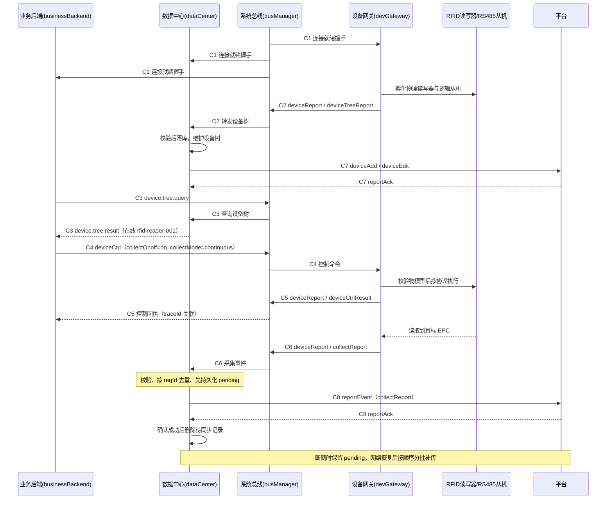

# 边缘网关基础方案

> 本文只回答三个问题：**模块怎么划分、边界在哪里**；**以耳标项目为例，一条完整流程需要哪些通信**；**最小链路怎么跑起来**。

## 一、方案定位

- 设备与边缘层负责把现场设备接进来、把数据采上来，并在本地完成推理、策略执行和弱网下的自主运行，是现场设备与中心平台之间的关键一层。
- 目标是一套边缘底座承载多个项目：**更换一种设备或协议时只适配设备网关，其他环节不改动**；新增一个场区不重新接入和联调。
- 对上游只暴露一套统一数据模型，业务只面对数据模型编程。
- 云边不可用时，现场采集、本地业务与断网补传仍照常运行。

## 二、模块划分

### 2.1 固化骨架与可选业务 App

固定骨架（所有项目都必须存在）：`busManager`、`dataCenter`、`sysManager`（含内部日志服务 `logServer`）、`devGateway`。
可按业务增删：`businessBackend`、`algorithmService`、`ruleEngine`。耳标项目中的“耳标业务后端”即 `businessBackend` 在本项目中的实例。

| 模块 | 定位 | 负责 | 不负责 |
|---|---|---|---|
| `busManager` 系统总线 | 节点内统一消息底座 | 本地发布/订阅路由、同步调用关联、连接就绪握手、云端 Topic 适配与唯一 MQTT 出口 | 不解析业务载荷；不保存业务离线队列；不代替业务方做幂等；不承载视频和大数据本体 |
| `devGateway` 设备网关 | 系统总线与现场设备之间的适配层 | 设备孵化与设备树、在线状态、协议私有数据、物模型属性控制执行、采集事件生成 | 不访问云端；不做业务规则与设备选择；不做长期存储；串口句柄等运行时私有数据不对外暴露 |
| `dataCenter` 数据中心 | 本地数据缓存、查询与云端同步中心 | 设备树与业务数据的本地持久化、基础查询、先持久化后发送、平台确认后清理、断网补传 | 不做协议解析与设备控制；不做业务规则、分析、推理、告警；不保存协议私有数据 |
| `sysManager` 系统管理 | 节点统一运维底座 | 配置、日志（`logServer`）、指标、升级回滚、时间同步、进程守护 | 不参与任何设备与业务数据处理 |
| `businessBackend` 业务后端 | 业务决策者 | 业务规则与流程编排：查设备树选设备、何时下发什么控制、如何消费采集事件 | 不直接操作设备硬件；不自行维护设备/地址副本；不绕过数据中心向平台上报 |
| `algorithmService` 算法服务 | 数据分析者 | 识别、预测、计算，输出结果 | 不控制设备；不做业务决策 |
| `ruleEngine` 规则引擎 | 规则判断 | 依据数据判断是否触发动作或告警 | 不解析设备协议；不直接写本地库 |

### 2.2 依赖与启动顺序

启动依赖固定为：`busManager` → `dataCenter` → `sysManager` / 其他业务 App → `devGateway`。

- `busManager` 必须先提供可用的本地发布订阅能力。
- `dataCenter` 必须先创建并持久化根设备，并对外提供根设备 ID。
- `devGateway` 只有在取得根设备 ID 后才能孵化设备并挂载设备树，避免设备节点缺少父节点。
- App 不应仅以“接入返回成功”判定业务可用，还需完成连接就绪握手后才启动业务流程。

### 2.3 边界原则

1. **唯一责任方**：消息流转只由 `busManager` 负责；设备协议与设备控制只由 `devGateway` 负责；需要持久化的数据由 `dataCenter` 负责落库与上报。
2. **不共享运行时私有数据**：协议句柄、通信地址映射、运行时状态只留在所属模块内部，不通过总线传递、不落库。
3. **业务逻辑不外溢**：任何“这头猪该不该告警”“该控制哪台设备”的判断都属于业务后端/规则引擎，不属于骨架模块。
4. **唯一上云通道**：`busManager` 是节点内唯一持有 MQTT 客户端的模块，任何模块需要与平台通信都必须经总线中转，不得绕过总线直接访问平台；`dataCenter` 负责需要持久化数据的上报，但不是唯一可上云的业务。
5. **大数据旁路**：视频走 RTSP/WebRTC 直连，图像、点云、音频块走独立数据面，总线只传引用、通知和结果。
6. **边界由协议固定，不由示例固定**：`deviceCtrl`、`deviceReport` 是通用接口，不因当前示例是 RFID 就变成设备网关专用。

## 三、模块间通信总则

- 所有跨模块通信都经 `busManager`，模块之间不直接耦合。总线不涉及任何业务，只提供一套面向协议的开发方式。
- 本地通信以 `intent` 作为主题路由，消息体中的 `type` 只描述载荷语义，不参与路由。
- 统一信封字段：`reqId`（幂等键）、`traceId`（调用链关联）、`type`、`timestamp`、`source`、`data`。**命令消费者按 `reqId` 幂等，事件消费者按 `reqId` 去重，同一业务请求及其后续事件共用 `traceId`**。
- 发布时用 `dst` 区分路径：`dst = local` 走本地主题；`dst = cloud` 表示平台业务动作，由 `busManager` 完成平台 Topic 适配与上行，业务方不直接连 MQTT。
- 云边两级协议严格隔离：本地用《对接协议_APP.md》，平台用《对接协议_平台.md》，`dataCenter` 是二者之间唯一的适配层。
- 上行只保证“至少一次投递 + 业务幂等”，不假设恰好一次；平台 `reportAck` 是唯一的业务确认，QoS 投递成功不等价于业务成功。
- 需要可靠上云的消息由发起方负责可靠性；`busManager` 的职责止于本次转发。

## 四、以耳标项目为例：完整流程需要哪些通信

### 4.1 角色与设备树

```text
root_device                         （数据中心（`dataCenter`）初始化）
└── rfid-reader-001                 （物理设备，modelId=101，RFID_reader）
    ├── rfid-reader-001-slave-01    （逻辑设备，RS485 从机）
    └── rfid-reader-001-slave-02    （逻辑设备，RS485 从机）
```

- RFID 读写器直接挂载在根设备下，标识为物理设备；RS485 从机是挂在读写器下的逻辑设备，不代表独立物理接入。
- 读写器使用 `101.mdl`：属性 `collectOnoff`（`on`/`off`）、`collectMode`（`continuous`/`once`），事件 `collectReport`（`EPC`、`deviceId`、`timestamp`）。
- 本期采集属性控制只发给 RFID 物理读写器，不发给逻辑从机。

### 4.2 通信清单

| 编号 | 通信 | 参与方 / 方向 | 通道（`intent`） | 关联键 | 说明 |
|---|---|---|---|---|---|
| C1 | 连接就绪握手 | 任意 App ⇄ `busManager` | `busConnectionRequest` / `busConnectionResult` | `reqId`，结果复用为 `traceId` | App 业务可用的前置条件；断连或路由重启后须重新握手 |
| C2 | 设备树上报 | `devGateway` → `dataCenter` | `deviceReport`，`type=event`，`name=deviceTreeReport` | 消息 `reqId` | 启动孵化完成、设备上下线或拓扑变化时上报完整设备树 |
| C3 | 设备树查询 / 结果 | `businessBackend` ⇄ `dataCenter` | `deviceQuery` / `deviceQueryResult` | 请求与结果同 `traceId` | 业务后端定位可控制设备的唯一来源；不得自建设备地址副本 |
| C4 | 采集控制属性下发 | `businessBackend` → `devGateway` | `deviceCtrl`，`type=property` | `reqId`（幂等）、`traceId` | 设置 `collectOnoff` / `collectMode`；属性必须来自物模型 |
| C5 | 控制回执 | `devGateway` → 订阅方 | `deviceReport`，`type=event`，`name=deviceCtrlResult` | 复用 C4 的 `traceId`，回执带 `commandReqId` | 返回 `success` / `failed` 及失败原因 |
| C6 | 采集事件上报 | `devGateway` → `dataCenter`（业务/规则可选订阅） | `deviceReport`，`type=event`，`name=collectReport` | `reqId` 为事件全局幂等键 | 携带 `EPC`、`deviceId`、`timestamp`；采集一次发布一次，不做发布侧窗口去重 |
| C7 | 设备变更上云 / 确认 | `dataCenter` ⇄ 平台 | `deviceAdd` / `deviceEdit` / `deviceDel` ⇄ `reportAck` | 复用本地 `reqId` | 由 C2 的设备树变更转换而来；确认成功才清理本地待同步记录 |
| C8 | 采集事件上云 / 确认 | `dataCenter` ⇄ 平台 | `reportEvent` ⇄ `reportAck` | 每个事件元素独立稳定派生的 `reqId` | 透传 `EPC` 与事件时间，不得用补传时间覆盖 |
| C9 | 统一日志 | 任意 App → `sysManager`(`logServer`) | 日志作为 `resource` 发布，`logServer` 订阅 | — | 统一终端输出与本地落盘，不额外引入独立通道 |
| C10 | 结果消费（可选） | `dataCenter`/`algorithmService`/`ruleEngine` ← `devGateway` | 订阅 C6 同一事件 | `traceId` | 可做实时业务处理，但**不得再次向平台上报** |
| C11 | 平台下行命令（可选） | 平台 → 本地 App | 平台 Topic 解析出的 `intent` 作为本地主题 | 载荷自带 `reqId` | 下行先经 `dataCenter` 校验主题、租户、边缘标识与报文，不直接转发给现场设备（本例业务流程约定；框架不强制下行必须经过某个 App） |
| C12 | 运维类通信（可选） | `sysManager` ⇄ 平台 | 配置下发、指标上报、升级、时间同步 | 各自协议 | 与业务数据通道分离，弱网时不得挤占业务带宽 |

**本期耳标项目必须打通的是 C1–C9**；C10–C12 属于可选项，不阻塞最小链路。

### 4.3 一条完整业务链路的通信顺序



### 4.4 通信层面的关键约定

1. **控制必须走物模型**：`deviceCtrl` 的属性名和取值必须存在于目标设备物模型且可写，`101.mdl` 只允许 `collectOnoff`、`collectMode`；该物模型没有可调用事件，不能以 `type = event` 下发 `collectReport`。
2. **控制有前置条件**：设备树未同步到 `dataCenter`、目标设备不在线时，业务后端不得下发控制；对逻辑从机下发本期采集控制应被拒绝。
3. **采集事件可追溯**：`source.deviceId`、`data[].deviceId`、`data[].args.deviceId` 必须一致。
4. **幂等分工明确**：控制命令按 `reqId` 幂等由 `devGateway` 处理；采集事件按 `reqId` 去重由 `dataCenter` 处理；总线允许重复投递。
5. **全链路可追踪**：一次业务请求的控制命令、控制回执、采集事件、平台上报必须能通过同一 `traceId` 串起来；补传只改变发送时间，不改变 `reqId`、`traceId`、业务数据和事件时间。
6. **采集一次发布一次**：协议服务读到一次 `EPC` 就发布一次采集事件，不做发布侧窗口去重；同一事件的语义去重由 `dataCenter` 按 `reqId` 负责。
7. **失败不伪造数据**：读写器离线或协议执行失败时只返回 `deviceCtrlResult` 失败，不产生伪造的 `collectReport`。
8. **弱网可用性**：云端不可用时本地采集继续，`dataCenter` 保留 `pending` 记录并在恢复后补传；缓存达到上限时按“保留最新”策略淘汰最旧待补传记录，并记录告警。

## 五、最小链路实现路径

### 5.1 最小目标与范围

**目标**：一台 RFID 读写器孵化成功并同步到本地设备树，业务后端能查到它并下发一次采集属性控制，读取到一个耳标 EPC，数据能在本地落库并在平台确认后完成上云；断网期间不丢事件。

**明确不做**：算法服务、规则引擎、多设备拓扑、动态入网发现、OTA 升级、指标采集、权限与订阅边界、平台下行业务控制。

### 5.2 分阶段推进

| 阶段 | 交付物 | 关键前置 | 验收标准 |
|---|---|---|---|
| 阶段 0：冻结约定 | 信封字段、`intent` 清单、`101.mdl` 物模型、平台 `pk`/`dn` 与 Topic 约定 | 与平台端、业务端对齐协议内容 | 三方对《对接协议_APP.md》《对接协议_平台.md》无异议 |
| 阶段 1：`busManager` | 本地发布/订阅、连接就绪握手、`dst=cloud` 上行适配与唯一下行入口 | 无 | 任意 App 能发布/订阅本地主题；握手失败可重试；云端异常不影响本地通信 |
| 阶段 2：`sysManager`（`logServer`） | 统一日志接口与汇聚落盘 | 阶段 1 | 所有 App 使用同一日志接口，`logServer` 统一输出并落盘 |
| 阶段 3：`dataCenter` | 根设备创建、设备树与业务数据落库、设备树查询、先持久化后上报与断网补传 | 阶段 1、根设备 ID 可用 | 根设备已持久化；`deviceQuery` 能返回设备树；收到 `reportAck` 才清理待同步记录；断网恢复后按序补传，实时数据优先 |
| 阶段 4：`devGateway` | 复用已有 RS485 能力，完成 RFID 读写器及从机孵化、设备树上报、属性控制执行、`collectReport` 上报 | 阶段 1、阶段 3 提供根设备 ID | 设备树形如“根设备 → 物理读写器 → 逻辑从机”；属性控制返回回执；读到 EPC 后即上报 `collectReport`（采集一次发布一次） |
| 阶段 5：业务后端 | 设备树查询 → 选择在线 RFID 物理设备 → 下发 `collectOnoff`/`collectMode` → 用 `traceId` 关联回执与采集事件 | 阶段 3、阶段 4 | 一次控制能观察到完整的 控制 → 回执 → 采集事件 链路；设备树未同步时不下发控制 |
| 阶段 6：端到端联调 | 全链路联调与异常演练 | 阶段 1–5 | 见 5.3 异常验收表 |

### 5.3 最小链路的异常验收

| 场景 | 预期表现 |
|---|---|
| 设备孵化失败 | `devGateway` 记录原因并上报当前可用设备树，失败节点不被当作可控制设备 |
| 设备树未同步 | 业务后端不下发控制，先等待或重试查询 |
| 对逻辑从机下发采集控制 | `devGateway` 返回 `failed`，业务后端改向父物理设备下发 |
| 物模型或参数不匹配 | `devGateway` 拒绝命令，不访问 RS485 设备 |
| 读写器离线或协议执行失败 | 返回 `deviceCtrlResult` 失败，不产生伪造采集事件 |
| 总线重复投递 | 控制按 `reqId` 幂等，采集事件按 `reqId` 去重 |
| 云端不可用 | 本地采集继续，待同步记录保留，恢复后补传 |
| 平台返回失败或确认非法 | 不清理待同步记录，继续重试 |

### 5.4 依赖顺序小结

```text
阶段 0 冻结协议
        │
        ▼
阶段 1 busManager（通信底座 + 握手）
        │
        ├──────────────► 阶段 2 sysManager / logServer（可并行）
        ▼
阶段 3 dataCenter（根设备 + 查询 + 待同步与补传）
        │
        ▼
阶段 4 devGateway（孵化 + 控制 + 采集）
        │
        ▼
阶段 5 业务后端（查询 → 控制 → 关联）
        │
        ▼
阶段 6 端到端联调与异常验收
```

### 5.5 联调前检查项

- [ ] `intent` 与信封字段三方已冻结，物模型 `101.mdl` 与设备实际上报字段一致。
- [ ] 启动顺序满足 `busManager` → `dataCenter` → 其他 App → `devGateway`，且 `devGateway` 已拿到根设备 ID。
- [ ] 各 App 已通过连接就绪握手后再启动业务。
- [ ] 平台已具备 `deviceAdd`/`deviceEdit`/`deviceDel`、`reportEvent` 的处理与 `reportAck` 回执能力。
- [ ] 平台侧按 `reqId` 保留去重记录，保存时间不短于边缘最大补传窗口。
- [ ] 已确认视频与大数据不经总线传输，总线只承载控制、状态、遥测与结果类小消息。

## 附：相关文档

| 内容 | 文档 |
|---|---|
| 本地 App 间协议、`intent` 与信封 | 《对接协议_APP.md》 |
| 云边协议、平台 Topic、确认与补传 | 《对接协议_平台.md》 |
| 耳标项目业务流转细节 | 《猪只耳标处理流程.md》 |
| RFID 物模型 | `101.mdl` |
| 整体架构与分层 | 《overallDesign.md》 |
| 各模块内部设计 | 《busManager.md》《devGateway.md》《dataCenter.md》《logServer.md》（`sysManager` 保留骨架地位，本版本暂不单独出文档） |
