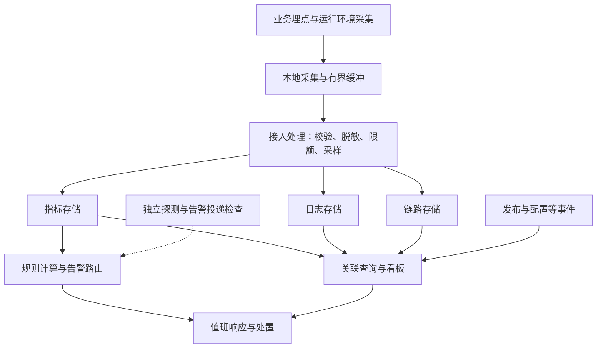

# 可观测性平台建设：从业务目标到架构判断

> 本文承接[《00整体设计》](./00整体设计.md)中“可观测性平台建设”的范围，覆盖操作系统、JVM、基础设施，以及业务系统的业务运行指标、技术运行指标和全链路监控。目标是理解如何设计观察点、组织证据和支撑决策；工具与部署配置只作为实现手段。

## 第 1 章 可观测性在高可用架构中的位置

高可用设计不仅要考虑故障发生后如何继续服务，还要回答：怎样知道服务已经受损，怎样判断影响范围，怎样确认恢复措施有效。缺少这些反馈，冗余、重试、限流和回滚都可能在错误的时间执行，或者执行后无人知道结果。

### 1.1 从系统状态推断用户影响

本文将可观测性理解为：借助系统对外输出的指标、日志、链路和事件，推断其内部运行状态，并解释用户看到的结果。监控通常把已知关注点固化为看板和规则；良好的可观测性还支持故障发生后提出新问题、按不同维度追查证据。两者在工程上相互支撑。

例如，“进程存活”“接口返回 HTTP 200”“用户成功下单”是三个不同判断：进程可能活着却无法获取数据库连接，接口可能返回成功却没有生成订单，订单可能生成但后续消息长期未被消费。**观察点必须跟随业务承诺跨越组件边界。**

可观测性参与的反馈过程如下：


这个过程强调反馈关系，不要求所有动作都自动完成。自动恢复也必须有触发条件、执行边界和结果验证。

### 1.2 明确本章与其他高可用能力的边界

按照总设计，本章负责提供事实与反馈，其他章节负责展开相应的控制机制。

| 相邻主题 | 本章需要提供的证据 | 由相应主题展开的机制 |
| --- | --- | --- |
| 高可用原则与可靠基础设施 | 冗余是否仍然存在，依赖是否健康 | 备份、容灾、基础设施选型 |
| 无状态与有状态服务 | 请求失败、重试放大、复制延迟、状态收敛情况 | 重试、幂等、复制、共识与再平衡 |
| 流量管理 | 接受、拒绝和降级的流量及其业务影响 | 限流、降级、隔离 |
| 事务管理 | 业务状态是否到达预期终态，补偿是否积压 | 一致性协议与补偿方案 |
| 混沌工程与运维保障 | 故障何时被发现，恢复是否有效 | 故障注入、发布、回滚及处置流程 |

因此，建设平台的出发点应是“需要支持哪些判断”，随后才决定数据和工具。平台能帮助缩短发现与定位时间，但服务本身的隔离、容错与恢复能力仍需独立设计。

## 第 2 章 从业务承诺反推观测目标

先确定用户要完成的任务及可接受结果，再选择指标，可以避免采集大量数据却无法判断服务是否可用。

### 2.1 用 SLI、SLO 和错误预算表达目标

服务水平指标（SLI）是对服务表现的度量，服务水平目标（SLO）是该度量在指定统计窗口内应达到的目标；若另有包含违约后果的对外约定，则属于服务水平协议（SLA）。三者不应混用。[定义参考 Google SRE](https://sre.google/sre-book/service-level-objectives/)。

以下单为例，先写清业务承诺：“用户提交有效请求后，系统应在可接受时间内完成约定的订单处理。”再把它拆为独立、可验证的目标。

| 目标 | 示例 SLI | 必须明确的口径 |
| --- | --- | --- |
| 下单可用性 | 成功完成约定处理的有效请求数 / 有效请求总数 | 入口范围、成功判据、超时和拒绝如何计入 |
| 下单时延 | 在 1 秒内成功完成的有效请求数 / 有效请求总数 | 起止观察点、超时请求的归属 |
| 异步处理及时性 | 在 60 秒内到达约定终态的订单数 / 已到处理期限的应处理订单数 | 创建时间分组、处理期限、迟到结果如何修订 |

表中的时限仅用于教学，应由用户体验、依赖能力和成本共同决定。明确“已到处理期限”可以避免把刚进入系统、尚未到期的任务误判为失败；如果终态不能在入口直接判断，就需要后续结果事件或核对任务补充证据。

计数还要说明观察的是“一次用户操作”“一次入口请求”还是“一次内部调用尝试”。内部重试可能产生多次调用，直接用它们衡量用户成功率，会改变分母并掩盖真实体验。排除无效请求也应形成明确规则，不能把过载时被拒绝的有效请求从统计中移除。

假设请求型 SLO 为“30 天内成功率至少 99.9%”，窗口中有 1,000,000 次有效请求，则允许的不良请求预算为：

```text
错误预算比例 = 1 - 99.9% = 0.1%
窗口内错误预算 = 1,000,000 × 0.1% = 1,000 次不良请求
```

这是按请求计数的预算，不能直接换算成固定停机分钟数：业务流量并不均匀，高峰期的短故障可能损失更多请求。预算的用途是帮助团队决定是否继续发布、何时优先投入可靠性改进，而非追求脱离成本的无限可用性。

### 2.2 同时设计结果信号与解释信号

结果信号回答“业务是否受损”，解释信号回答“哪些环节可能导致受损”。前者适合决定事件优先级，后者帮助缩小排查范围；资源耗尽等明确的迫近风险也应提前处理。

| 架构问题 | 优先观察的结果 | 用于解释的内部证据 |
| --- | --- | --- |
| 用户能否完成下单 | 业务成功率、端到端时延 | 错误类型、连接等待、依赖调用耗时 |
| 订单后续处理是否及时 | 到期完成比例、最老待处理任务年龄 | 消费吞吐、重试次数、死信与分区分布 |
| 服务还能承受多少负载 | 时延变化、拒绝比例 | 线程池排队、连接池等待、CPU 限流 |

应结合从用户路径执行的黑盒探测与内部白盒数据。探测可以覆盖真实流量不足时的盲区，内部数据可以解释故障及提前暴露风险；探测成功也只能证明探测覆盖的路径可用。[黑盒与白盒的关系参考 Google SRE](https://sre.google/sre-book/monitoring-distributed-systems/)。

## 第 3 章 按四个层次组织观察点

总设计中的操作系统、JVM、基础设施和业务系统构成不同的观察层次。同一故障会在多个层次留下表现，架构设计的任务是把这些表现连成可验证的解释，而不是分别建立互不关联的看板。

### 3.1 操作系统：判断资源约束与共享影响

操作系统观测用于判断进程获得的实际资源，以及同机服务是否互相影响。容器场景还应区分宿主机、容器资源限制与进程三个视角。

| 观察对象 | 代表性证据 | 可支持的判断与限制 |
| --- | --- | --- |
| CPU | 使用率、运行队列、容器 CPU 限流时间 | 区分计算需求与配额约束；宿主机空闲不代表容器未被限流 |
| 内存 | 进程常驻内存、容器用量与限制、回收和 OOM 事件 | 判断总内存压力；JVM 堆未满不代表进程不会 OOM |
| 存储 | 空间、inode、I/O 时延、队列与错误 | 区分容量不足和读写变慢；有剩余空间也可能无法及时写入 |
| 网络 | 流量、重传、丢包、连接状态和错误 | 支持定位网络异常；还需结合链路两端证据判断位置 |

原则是将**利用率、等待和错误结合起来观察**。CPU 使用率升高可能只是正常承载更多业务；只有结合排队、时延和吞吐，才能判断它是否成为瓶颈。

### 3.2 JVM：解释运行时如何影响服务能力

JVM 观测需要回答内存管理、线程执行与业务时延之间的关系。具体指标依赖 JDK、垃圾收集器和部署方式，不应把某一种配置下的阈值直接推广到所有服务。

| 观察对象 | 代表性证据 | 需要验证的假设 |
| --- | --- | --- |
| 堆与垃圾回收 | 堆使用趋势、分配速率、回收后占用、GC 暂停分布 | 内存增长是否持续，暂停是否与请求变慢重叠 |
| 非堆与进程内存 | 元空间、直接内存、线程数量、进程与容器总内存 | 堆外开销是否造成内存压力，是否接近部署限制 |
| 线程执行 | 活跃线程、阻塞与等待状态、线程池队列和拒绝数 | 请求是在执行、等锁，还是等待外部资源 |
| 诊断剖析 | 线程栈、JFR 或性能剖析结果 | 具体热点、锁竞争或分配来源是否符合假设 |

“GC 次数多”本身不足以判定故障，“GC 后堆占用持续增长”也只能提出泄漏等候选假设，还需要结合负载、缓存策略及对象证据验证。线程池排队同样不意味着线程数一定太小，可能是数据库连接等待拉长了任务执行时间。

常态采集保留低开销趋势，深入诊断按需启用，并为采样时长、开销和导出量设定边界。获取诊断数据不应让已经受损的服务进一步失去处理能力。

### 3.3 基础设施：从可连接走向可服务

基础设施在本章主要指承载业务依赖的数据库、缓存、消息系统、网关及相关平台能力。除实例存活外，还要判断其对上层提供的能力是否符合要求。

| 依赖 | 关键观察点 | 对高可用判断的意义 |
| --- | --- | --- |
| 数据库 | 连接与等待、查询时延、锁等待、复制延迟 | 判断访问瓶颈；主库正常不能证明副本读取足够新鲜 |
| 缓存 | 命中率、访问时延、驱逐、内存与热点分布 | 判断回源压力；整体命中率正常也可能存在热点键问题 |
| 消息系统 | 生产与消费速率、积压、最老消息年龄、重投与死信 | 判断处理是否落后于业务期限；积压条数需结合流量解释 |
| 网关与负载均衡 | 接收与转发量、拒绝、上游错误、连接与实例分布 | 区分入口拒绝、转发失败及后端处理失败 |
| 服务发现与配置能力 | 更新时效、失败、客户端实际使用的版本 | 判断控制信息是否真正到达服务实例 |

同时记录依赖调用方的等待时间与依赖服务端的处理时间。例如数据库内部执行很快，但客户端耗时很长，问题可能发生在连接获取或网络阶段。只看一侧数据，很容易把整个等待过程归因给数据库执行。

### 3.4 业务系统：分开衡量业务结果与技术运行

业务运行指标度量业务动作及状态，例如下单成功率、支付完成率、超期未处理订单和补偿积压。技术运行指标描述实现过程，例如请求吞吐、错误率、时延分布、并发、排队与依赖失败。

两类指标要能互相解释：接口错误下降而超期订单增加，可能只是把同步失败转移到了异步队列；重试后成功率稳定而调用次数暴涨，说明容错正在消耗额外资源；降级后接口变快，仍要检查用户是否获得约定结果。

服务入口可以围绕流量、错误、时延和饱和程度组织技术指标，即四个黄金信号。时延应区分成功与失败，并查看分布，避免平均值掩盖少量严重慢请求。[四个黄金信号参考 Google SRE](https://sre.google/sre-book/monitoring-distributed-systems/)。

全局数据还应能按服务、版本、地域、可用区和关键业务类型下钻，以识别局部受损。分位数不能通过简单平均得到全局分位数，应使用可合并的分布数据计算；业务成功率也应汇总分子与分母后计算，避免直接平均不同流量实例的成功率。

## 第 4 章 用关联模型连接全链路证据

覆盖所有层次仍不足以快速定位故障。若不同数据无法关联，排障者依然要手动猜测：这条日志属于哪次调用，这次调用落在哪个版本和实例，该实例当时受到了什么资源约束。

### 4.1 按问题选择信号，再统一关联字段

| 信号 | 适合回答的问题 | 主要限制 |
| --- | --- | --- |
| 指标 | 何时开始异常，规模多大，哪些分组受损 | 聚合后通常无法还原单次请求 |
| 日志 | 某个业务动作发生了什么，失败时有哪些上下文 | 记录可能不完整，检索成本随数据量增长 |
| 链路 | 一次操作经过哪些服务，等待集中在哪里 | 受埋点覆盖、传播和采样影响 |
| 变更与运行事件 | 哪些发布、配置、扩缩容和切换发生在异常前后 | 时间相邻只能建立候选关联，不能证明因果 |

统一记录环境、服务名、版本、实例、地域或可用区、事件时间等资源信息；对具有请求上下文的日志记录 trace_id、span_id，对业务状态变化记录受控的业务关联标识。字段名称、含义、单位及负责人都需要形成契约。

统一关联字段不等于将所有字段都加入指标标签。订单号、用户标识、完整 URL 等取值空间很大的字段，更适合受控日志或链路属性。指标中的每种标签组合都会形成时间序列，标签维度相乘会迅速放大成本。[标签成本参考 Prometheus 官方实践](https://prometheus.io/docs/practices/instrumentation/)。

### 4.2 全链路监控必须覆盖执行边界

一次操作的端到端时延包括执行、网络、排队及各类等待；并行调用的时长会重叠，不能简单累加所有 span 的耗时。应沿关键路径判断阻塞，并检查没有被埋点覆盖的间隙。

同步调用可以通过传播上下文连接父子 span；线程切换、异步任务、消息投递和消费也需要显式或由框架支持地传递上下文。长时间运行的业务流程、消息批处理等场景，可以根据实际因果关系使用独立 trace 与 span link，而非强行串成一条无限延伸的父子链。[上下文传播机制参考 OpenTelemetry](https://opentelemetry.io/docs/concepts/context-propagation/)。

设计全链路时尤其要保留以下区分：

- **业务操作与调用尝试**：重试属于同一业务操作的不同尝试，应保留次数、原因和最终结果。
- **任务接受与任务完成**：消息发送成功只能证明一个中间阶段，应继续观察消费、业务提交及预期终态。
- **业务时间与采集时间**：数据可能延迟到达，查询和告警需明确使用哪个时间口径。

跨机器时钟存在偏差，不能仅凭两个墙上时钟时间戳相减就认定单向网络耗时。单机耗时宜由单调时钟测量，跨服务分析结合因果关系、同步状态及工具的时钟修正能力。

### 4.3 让采样策略服从诊断目标

链路量较大时，采样决定故障发生后还剩下哪些证据。

| 策略 | 主要收益 | 代价与盲区 |
| --- | --- | --- |
| 头部采样 | 在开始阶段决定是否记录，较早减少开销 | 当时不知道最终结果，可能漏掉罕见失败 |
| 尾部采样 | 根据已收集的错误、时延等信息选择保留 | 需要缓存、等待和按 trace 汇聚，增加资源与运维成本 |

尾部采样无法找回上游已经丢弃的 span，也无法保证在缓冲耗尽或数据迟到时保留所有异常。[采样机制参考 OpenTelemetry](https://opentelemetry.io/docs/concepts/sampling/)。

对于下单服务，一种可评估的方案是保留适量正常样本，并提高错误、慢请求和新版本的保留优先级。具体比例要根据流量和成本验证。SLO 所用计数应优先来自完整口径的计数器或业务结果数据，不能直接用偏向错误保留的链路样本计算总体失败率；必须使用样本时，需要可解释的估计方法并说明偏差。

## 第 5 章 把观测平台作为需要容错的系统设计

观测平台也会发生拥塞、存储故障和配置错误。业务越异常，日志、错误和链路数据越可能激增，因此容量设计必须覆盖故障期间，而不只是平稳时期。

### 5.1 建立职责清晰的数据链路

下面是逻辑结构，各职责可由同一产品承担，也可按规模拆分；并不要求为每个方框独立建设服务。



接入层承担数据契约与成本治理，存储层适配不同查询方式，查询与规则层面向判断和响应。工具选型应比较这些能力、团队维护成本和已有基础，而不是先列产品清单再拼接架构。

### 5.2 隔离业务路径与观测故障

一般诊断遥测采用异步导出、有界队列、明确超时及可观测的丢弃策略。后端不可用时，业务线程不应无限等待；采集器也不能因无限重试耗尽内存或写满业务磁盘。

| 故障情形 | 设计策略 | 必须显式接受的代价 |
| --- | --- | --- |
| 观测后端暂时不可达 | 限时重试、有界缓冲，必要时丢弃低优先级遥测 | 缓冲耗尽后存在数据缺口 |
| 异常日志激增 | 限速、重复聚合、保留代表性错误及丢弃计数 | 单次故障细节可能不完整 |
| 查询负载过大 | 限制范围与并发，按需隔离查询和写入资源 | 部分查询会变慢或被拒绝 |
| 采集代理失效 | 心跳、采集成功率、数据新鲜度与外部探测 | 额外检测链路也有维护成本 |

这里讨论的是诊断遥测。若业务审计或交易凭证要求持久化保证，应按相应一致性与留存要求单独设计，不能直接套用“队列满则丢弃”。

按业务重要性拆分限额、对采集代理设置资源约束，并评估平台与被观测服务是否共享同一故障域。独立探测和备用通知路径可以降低共因故障风险，但需要通过实际演练确认它们没有依赖同一网络、认证或消息通道。

### 5.3 显式处理成本、数据质量与访问边界

平台资源需求可先用简化模型估算，再由压测校准：

```text
指标活跃序列数 ≈ 各指标实际出现的标签组合数之和
日志日原始量 ≈ 平均每秒条数 × 平均单条大小 × 86,400
链路日原始量 ≈ 每秒请求数 × 平均 span 数 × 平均 span 大小 × 保留比例 × 86,400
```

这些只是原始量估算，还需要考虑峰值、索引、压缩、副本和保留期限。尾部采样减少最终保存量，但采样决定之前的数据接收与缓冲仍占资源。保留周期应由故障追溯、容量分析和成本目标确定。

数据质量同样是架构约束：缺失、延迟、重复、计数器重置、指标含义变化，都可能使判断失真。平台应展示采集延迟、丢弃量、规则执行状态和数据新鲜度；缺失数据不能默认为零错误，断流时应进入“未知”或“观测异常”状态。

采集字段采用明确范围，对敏感数据尽量在源头脱敏，限制原始日志、业务关联标识和查询结果的访问。这样既控制数据暴露，也防止无边界字段拖垮索引和查询。平台团队负责公共能力，业务团队负责业务语义、目标口径和告警处置，两者共同维护数据契约。

## 第 6 章 将数据转化为可执行的响应

采集完成只是具备了原料。告警和看板需要把这些原料组织成“是否需要行动、由谁行动、如何判断结果”的判断路径。

### 6.1 根据影响、紧迫性和可操作性分级

| 信号 | 响应方式示例 | 设计理由 |
| --- | --- | --- |
| 核心业务明显失败，错误预算快速消耗 | 紧急通知值班人员 | 延迟处置会扩大当前损失 |
| 预计短期耗尽磁盘，或关键冗余已经丢失 | 按剩余处置时间升级 | 尚未全面受损，但存在明确迫近风险 |
| 持续缓慢消耗预算、容量余量下降 | 工单与计划处理 | 需要行动，通常允许安排处理时间 |
| CPU 短暂升高、已预期的发布事件 | 看板或事件记录 | 单独证据不足以要求即时介入 |

避免给每个底层异常都发送紧急通知。对同一事故可聚合相关告警，但不要在未经验证的依赖推断下抑制关键业务告警，否则容易把并发故障一起隐藏。

一条可执行告警至少应包含：受影响业务与范围、统计窗口和当前值、目标或阈值、开始时间、负责人、关联看板、排查或处置手册。手册还应写明恢复动作的适用条件与验证标准，避免看到“连接池耗尽”就默认增加连接数。

### 6.2 用预算消耗速度连接 SLO 与告警

对前文按请求计数的 SLO，可定义：

```text
预算消耗速率（burn rate）= 观察窗口内不良请求比例 / (1 - SLO)
示例：SLO 为 99.9%，当前不良比例为 1%
预算消耗速率 = 1% / 0.1% = 10
```

这表示单位请求的不良比例为允许比例的 10 倍，不代表短窗口内已耗尽整个月的预算。实际预算消耗还需要结合该窗口请求量与完整统计口径计算。

短窗口能更快发现故障，也更容易受到短暂波动影响；长窗口更稳定，却可能响应较慢。可组合长短窗口判断持续性与当前状态，并使用不同严重程度的规则覆盖快速故障和缓慢恶化。低流量服务还需要结合失败数量、合成探测和业务重要性设计，避免为了降低噪声而完全屏蔽少量但关键的失败。[方法参考 Google SRE Workbook](https://sre.google/workbook/alerting-on-slos/)。

### 6.3 让看板支持推导，让恢复有明确判据

看板可以按以下路径组织：业务总览确定用户影响，服务与依赖视图缩小范围，实例与运行时视图检查约束，日志与链路验证具体假设，变更事件辅助寻找触发条件。下钻时应保留时间范围、环境、版本和业务维度。

恢复验证需要回到原始业务承诺：成功率与时延是否恢复，异步积压是否消退，重试量和资源压力是否回落，受影响分组是否都恢复。只看到告警停止或进程重启成功，不能证明业务已经恢复。

## 第 7 章 场景推导：下单变慢时如何形成架构判断

以下是用于说明推理方法的假设场景，不是实际事故记录。系统包含网关、订单服务、库存服务、数据库和异步消息消费，订单服务运行在 JVM 上。

### 7.1 用证据逐步缩小问题范围

假设订单服务发布后，下单时延上升，数据库相关 span 变长，但宿主机 CPU 并未显著升高。此时“数据库慢”“应该扩容”都还只是待验证假设。

| 步骤 | 观察到的证据 | 可以形成的判断 | 下一步验证 |
| --- | --- | --- | --- |
| 确认影响 | 下单时延 SLI 下降，有效请求超时增加 | 用户体验已经受损 | 是否集中在某版本、地域或业务类型 |
| 对比范围 | 同等请求类型下，新版本变慢，旧版本稳定 | 发布是候选触发因素 | 比较流量、路由和依赖是否可比 |
| 拆开等待 | 新版本连接获取耗时升高，数据库执行时延平稳 | 等待主要发生在执行 SQL 之前 | 检查活跃连接、持有时长和事务范围 |
| 跨层解释 | 线程池排队增加，堆和 GC 无明显异常 | 请求可能因等待连接占住线程 | 检查线程栈及连接使用路径 |
| 验证机制 | 新代码在远程调用期间仍持有数据库连接 | 连接持有时间被外部等待拉长 | 对比旧路径，并进行有边界的验证 |

宿主机 CPU 正常不能排除容器限流；GC 无异常不能排除其他 JVM 问题；发布与异常同时发生也不能直接证明因果。表中的判断依赖多种独立证据逐步收敛。

### 7.2 从处置选择反推需要补充的观测能力

在这个假设中，盲目增加数据库连接数可能将压力转移给数据库，增加线程数可能制造更多等待，开启额外重试还可能放大负载。更合理的候选措施是停止继续发布，并在兼容性允许时回退变更或关闭新路径；具体执行属于发布与运维方案的范围。

处置后，用相同业务口径观察：连接等待是否下降、下单及时成功比例是否恢复、后续订单是否补齐处理、数据库及下游是否出现新的压力。仅依靠一条成功链路不足以确认整体恢复。

复盘则把偶然发现转为持续能力：补充连接等待与持有时长的区分、版本维度的对比、事务内远程调用的审查，以及发布前后 SLI 对照。案例体现的架构思维是：**先量化影响，再提出候选机制，用证据排除其他解释，最后以业务结果验证干预。**

## 第 8 章 渐进建设与设计评审

平台建设可以从最重要的一条业务路径开始。先证明“能发现、能定位、能验证”，再增加覆盖面，避免一开始就承担超出团队维护能力的复杂度。

### 8.1 按决策能力分阶段交付

| 阶段 | 建设重点 | 可验证的交付标准 |
| --- | --- | --- |
| 建立基线 | 核心路径、责任人、SLI 口径与关键分层指标 | 能区分业务受损、资源风险和数据缺失 |
| 关联证据 | 统一字段、关键链路、日志关联、变更记录 | 能从业务异常下钻到候选故障范围 |
| 形成响应 | 告警分级、值班路由、手册和恢复判据 | 演练能触达责任人，并验证处置效果 |
| 持续治理 | 采样、基数、保留策略、平台自身容错 | 故障高峰下开销受控，数据缺口可见 |

这些是能力的成熟顺序，不意味着平台自身保护可以最后才考虑。有界缓冲、资源限额和敏感字段控制应从首次接入开始具备。

演练同时覆盖业务故障和观测故障：例如依赖变慢、消息消费暂停、单实例异常，以及采集器退出、存储不可达、告警通道失效。记录故障发生、被发现、通知到达、开始处置和业务恢复的时间，区分平台延迟与人工处理延迟。

### 8.2 用问题检查设计是否真正闭合

完成设计后，应能清楚回答：

1. 哪些用户任务构成核心承诺，SLI 的分子、分母、观察点与窗口是什么？
2. 操作系统、JVM、基础设施和业务系统的数据，能否解释同一次异常？
3. 同步、异步、重试和降级是否都有明确的业务结果口径？
4. 是否能识别局部受损、长尾请求及错误结果，而非只看全局平均值？
5. 采样、数据延迟和缺失会隐藏什么，界面与规则如何表达未知状态？
6. 观测后端故障时，业务路径和采集资源是否仍受控？
7. 每条紧急告警由谁处理，行动条件、证据入口与恢复标准是什么？
8. 新增数据的诊断价值是否值得其成本，能否通过演练证明？

评价平台建设成效，应关注发现是否及时、定位是否有证据、恢复是否得到验证，以及这些能力是否能以可承担的成本持续运行。
