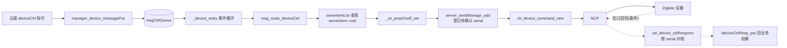
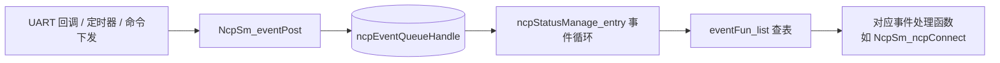

# 嵌入式 事件驱动模型

> 核心原则：**将系统行为建模为"事件→处理"的响应链；事件的生产者不关心谁来消费，消费者不关心事件从哪来，两者通过事件总线或队列解耦。**
>
> 背景：在嵌入式项目里，按键、传感器数据就绪、定时器超时、通信接收完成等都是天然的事件源。事件驱动模型能让模块间耦合降到最低，增减功能不影响已有逻辑。

## 1. 核心思想

事件驱动模型的核心是把"发生了什么"和"要做什么"分开。系统运行时，各模块向事件中心投递事件，已注册的处理器根据事件类型做出反应。

```text
传感器 → 按键 → 定时器 → 通信接收 → ...
          ↓
      事件队列 / 事件总线
          ↓
   处理器A  处理器B  处理器C
  （电机）  （日志）  （显示）
```

这种方式下，新增一个"收到数据后亮灯"的需求，只需新增一个事件处理器，无需改动传感器或通信模块的代码。

## 2. 轮询 vs 中断 vs 事件驱动

三种模型在嵌入式中的对比：

| 模型 | 原理 | 优点 | 缺点 |
|------|------|------|------|
| 轮询 | 主循环不断检查各模块状态 | 简单、确定性强 | 空转浪费 CPU，响应不及时 |
| 中断 | 硬件触发 ISR，直接处理 | 响应最快 | ISR 内不宜做复杂操作，嵌套复杂 |
| 事件驱动 | 中断/任务产生事件，由调度层分发 | 解耦好、可扩展 | 引入队列开销，事件顺序需关注 |

实际项目中通常是混合使用：中断捕获硬件信号后只投递事件，由任务级的事件循环统一处理：

```c
// ISR 中：只投递事件，不处理业务
void button_isr(void)
{
    event_t evt = { .type = EVENT_BUTTON_PRESS, .data = BUTTON_ID_A };
    event_queue_push(&g_event_queue, &evt);
}

// 任务中：消费事件，执行业务
void event_handler_task(void)
{
    event_t evt;
    while (1) {
        if (event_queue_pop(&g_event_queue, &evt, portMAX_DELAY)) {
            dispatch_event(&evt);
        }
    }
}
```

## 3. 事件驱动的基本要素

一个最小的事件驱动框架需要三个部分：

```c
// 1. 事件定义
typedef enum {
    EVENT_NONE = 0,
    EVENT_BUTTON_PRESS,
    EVENT_BUTTON_RELEASE,
    EVENT_SENSOR_DATA_READY,
    EVENT_TIMER_TIMEOUT,
    EVENT_UART_RX_DONE,
    EVENT_COUNT
} event_type_t;

typedef struct {
    event_type_t type;
    void       *data;
    uint32_t    data_len;
    uint32_t    timestamp;
} event_t;

// 2. 处理器注册表
typedef void (*event_handler_t)(const event_t *evt);

typedef struct {
    event_type_t    type;
    event_handler_t handler;
} event_subscription_t;

// 3. 分发函数
void dispatch_event(const event_t *evt)
{
    for (int i = 0; i < g_subscription_count; i++) {
        if (g_subscriptions[i].type == evt->type) {
            g_subscriptions[i].handler(evt);
        }
    }
}
```

一个事件可以被多个处理器订阅（比如按键事件同时触发电机动作和日志记录），也可以先到先处理（通过队列保证顺序）。

## 4. C 语言中的实用做法

- 事件类型用枚举集中管理，新增事件只需加一个枚举值。
- 事件数据用 `void *` 保持通用；约定好每个事件类型对应的数据结构，用 `data_len` 校验。
- 队列优先用 FreeRTOS 的 `xQueue` 或自己实现的环形缓冲，保证 ISR 和任务间的安全传递。
- 处理器注册用静态数组或链表；静态数组简单且确定性强，链表灵活但需要管理内存。
- 可以在事件中带上时间戳，方便做按键消抖、超时判断等。

一个带多订阅者的完整例子：

```c
// 处理器
static void motor_on_button(const event_t *evt) { motor_start(); }
static void led_blink_on_button(const event_t *evt) { led_blink(3, 200); }
static void log_on_button(const event_t *evt) { log_write("button pressed"); }

// 注册
static const event_subscription_t g_subscriptions[] = {
    { EVENT_BUTTON_PRESS, motor_on_button },
    { EVENT_BUTTON_PRESS, led_blink_on_button },
    { EVENT_BUTTON_PRESS, log_on_button },
};
```

新增需求（比如按键时也上报云端）只需加一行注册，不影响 `motor_on_button`、`led_blink_on_button`、`log_on_button` 和按键 ISR 的任何代码。

## 5. 对比例子：传感器数据处理

需求：温度传感器每 1 秒更新数据。超过 60°C 时开风扇并记录日志，低于 55°C 时关风扇。

**传统轮询写法**把所有逻辑揉在主循环里：

```c
void main_loop(void)
{
    while (1) {
        float temp = sensor_read_temperature();

        if (temp >= 60.0f && !g_fan_on) {
            fan_on();
            g_fan_on = true;
            log_write("fan on, temp=%.1f", temp);
        }
        if (temp <= 55.0f && g_fan_on) {
            fan_off();
            g_fan_on = false;
            log_write("fan off, temp=%.1f", temp);
        }

        vTaskDelay(pdMS_TO_TICKS(1000));
    }
}
```

问题：风扇和日志的逻辑与传感器读取绑定在一起，想加入"超温蜂鸣报警"就得改主循环，模块无法独立测试。

**事件驱动写法**将传感器、风扇、日志拆分为独立模块：

```c
// 传感器任务：只负责读取，投递事件
void sensor_task(void)
{
    while (1) {
        float *temp = malloc(sizeof(float));
        *temp = sensor_read_temperature();

        event_t evt = {
            .type     = EVENT_SENSOR_DATA_READY,
            .data     = temp,
            .data_len = sizeof(float)
        };
        event_queue_push(&g_queue, &evt);
        vTaskDelay(pdMS_TO_TICKS(1000));
    }
}

// 风扇处理器：只负责判断和执行
void fan_on_sensor(const event_t *evt)
{
    float temp = *(float *)evt->data;
    static bool fan_on = false;

    if (temp >= 60.0f && !fan_on) { fan_on = true; gpio_set(FAN_PIN); }
    if (temp <= 55.0f && fan_on)  { fan_on = false; gpio_clear(FAN_PIN); }
}

// 日志处理器：只负责记录
void log_on_sensor(const event_t *evt)
{
    float temp = *(float *)evt->data;
    if (temp >= 60.0f || temp <= 55.0f) {
        log_write("temp=%.1f", temp);
    }
}

// 注册
g_subscriptions[] = {
    { EVENT_SENSOR_DATA_READY, fan_on_sensor },
    { EVENT_SENSOR_DATA_READY, log_on_sensor },
};
```

优点：传感器、风扇、日志三个模块互不感知；加蜂鸣报警只需新增处理器注册，不改任何已有代码；每个处理器可以独立用模拟事件数据做单元测试。

代价：引入了堆分配（`malloc`），可用静态内存池替代；事件投递和分发有开销，高频率传感器（如 IMU 1kHz）不适合逐帧投递事件，应该批量或直接在驱动层处理。

## 6. 按键消抖的实践

按键是事件驱动最常见的场景。在 ISR 里投递原始事件，由任务层做消抖，再分发"确认按下"事件：

```c
// ISR 只投递原始事件
void button_isr(void)
{
    event_t evt = { .type = EVENT_BUTTON_RAW, .data = NULL };
    event_queue_push_from_isr(&g_queue, &evt);
}

// 消抖任务：原始事件 → 确认事件
void button_debounce_task(void)
{
    event_t evt;
    TickType_t last_tick = 0;

    while (1) {
        if (event_queue_pop(&g_queue, &evt, portMAX_DELAY)) {
            TickType_t now = xTaskGetTickCount();
            if ((now - last_tick) > pdMS_TO_TICKS(30)) {  // 30ms 消抖
                event_t confirm = { .type = EVENT_BUTTON_PRESS,
                                    .timestamp = xTaskGetTickCount() };
                event_queue_push(&g_queue, &confirm);
            }
            last_tick = now;
        }
    }
}
```

这样 ISR 极短、消抖逻辑独立、业务处理器不关心消抖——长按/短按/双击等扩展也很自然：在消抖层后加一层手势识别即可。

## 7. 适用范围

适合事件驱动的内容：
- 按键、触摸等用户输入
- 传感器数据就绪通知（低频）
- 通信接收完成（UART、CAN、BLE）
- 定时器超时和周期性任务
- 系统状态变化（充电插入、低电量告警）

不适合或需谨慎使用的内容：
- 高频数据流（IMU 1kHz、音频 PCM）——事件开销过大，用 DMA + 批量处理
- 严格实时控制的回路（电机电流环 PID）——事件分发延迟不可控
- 极简单的系统（单传感器 + 单执行器）——事件驱动反而过度设计

---

# 8. 本项目实例：zigbeeEngine —— 一个典型的多层事件驱动

> **结论：是，`codes/source/server/device/zigbeeEngine/` 是本项目里最能体现事件驱动模型的代码。** 它不是"某个函数用了事件驱动"，而是**整条链路都是事件驱动**：从 NCP（协处理器）收包，到属性分发，到设备控制，再到上层消息循环，每一层都是"事件入队 → 查注册表 → 调处理函数"这一模式。下面用真实代码逐层拆解。

## 8.1 整体结构：五张"事件表"

先给一张总览，本项目的事件驱动实现可以归纳为 5 个关键部件：

| 层级 | 文件 | 事件载体 | 处理函数注册表 | 说明 |
|------|------|----------|----------------|------|
| ① NCP 状态机 | `zigbeeHost/src/bl702/zmzigbee/zbhsot_ncpStatusManage.c` | 事件队列 `ncpEventQueueHandle` | `eventFun_list[]` | NCP 上电/复位/断线/入网等状态事件 |
| ② 属性/命令分发 | `client_zigbee.c` | 无队列（调用即分发） | `zigbeeAttribute[]` / `zigbeeCommand[]` | 把"cluster+attribute"映射到上报处理函数 |
| ③ 设备 Server | `server_zigbee.c` | 无队列（调用即分发） | `severItemList[]` | 把属性/命令名映射到 set/read/report |
| ④ 管理消息循环 | `manager/manager_device.c` | 双队列 `msgCtrlQueue` / `msgReportQueue` | `_dm_msgProc_ctrlTable[]` / `_dm_msgProc_reportTable[]` | 全工程消息的统一入口 |
| ⑤ 异步回包对账 | `server_sendManage.c` | 待确认链表（按 serial 关联） | — | 下发命令不阻塞，回包按 serial 匹配 |

> 注意：②③ 是"**表驱动分发**"（遍历表、按 key 匹配、调用函数），①④ 是"**队列 + 事件循环**"。二者都是事件驱动的两种典型形态——前者强调"注册表解耦"，后者强调"生产者/消费者解耦"。

## 8.2 四要素在本项目中的对应

对照本文第 3 节的"事件定义 / 处理器注册表 / 分发函数"三要素，本项目全部能找到一一对应：

- **事件定义**：`dm_message_t`（`name` 字段区分意图，如 `deviceCtrl`、`reportProp`、`reportEvent`、`dAdd`、`dDel`……）+ NCP 层的事件枚举 `zbhost_ncp_event_e`。
- **事件载体（队列）**：`dreQueueCreate(...)` 创建，`dreQueuePut()` 入队、`dreQueueGet()` 出队。
- **处理器注册表**：`eventFun_list[]`、`severItemList[]`、`zigbeeAttribute[]`、`_dm_msgProc_ctrlTable[]` 等静态表。
- **事件循环 / 分发函数**：`ncpStatusManage_entry()`、`_device_entry()`、`msg_route_deviceCtrl()`、`_client_zigbee_reprot()`。

## 8.3 第一层：NCP 状态机事件循环（最"教科书"的一段）

`zbhsot_ncpStatusManage.c` 几乎是第 2 节理论代码的工程化翻版，强烈建议作为入门阅读入口：

**① 事件类型定义（枚举）：**

```c
typedef enum {
    NCP_EVENT_ID_POWER_ON = 0x01,
    NCP_EVENT_ID_NCP_RESET_ACK,
    NCP_EVENT_ID_NCP_ERROR,
    NCP_EVENT_ID_ACK_TIMEOUT,
    NCP_EVENT_ID_NWK_CONFIG_FINISH,
    NCP_EVENT_ID_NCP_MFG_TEST,
    NCP_EVENT_ID_NCP_OTA_START,
    NCP_EVENT_ID_DEVICE_OTA_START,
} zbhost_ncp_event_e;
```

**② 处理器注册表（事件 id → 处理函数）：**

```c
static event_fun_t eventFun_list[] = {
    {NCP_EVENT_ID_POWER_ON,       ncpEvent_Poweron},
    {NCP_EVENT_ID_NCP_RESET_ACK,  ncpEvent_resetAck},
    {NCP_EVENT_ID_NCP_ERROR,      ncpEvent_ncpError},
    {NCP_EVENT_ID_ACK_TIMEOUT,    ncpEvent_ackTimeout},
    {NCP_EVENT_ID_NWK_CONFIG_FINISH, ncpEvent_nwkConfigFinish},
    {NCP_EVENT_ID_NCP_MFG_TEST,   ncpEvent_mfgTest},
    {NCP_EVENT_ID_NCP_OTA_START,  ncpEvent_ncpOtaStart},
    {NCP_EVENT_ID_DEVICE_OTA_START, ncpEvent_deviceOtaStart},
};
```

**③ 事件循环（消费队列 + 查表分发）：**

```c
static void ncpStatusManage_entry(void *pvParameters)
{
    ncpEvent_t *event = NULL;
    ncpEvent_Poweron(NULL);            // 上电先投递一个 POWER_ON 事件

    while (true)
    {
        event = dreQueueGet(ncpEventQueueHandle, 100);   // 阻塞取事件
        if (event)
        {
            for (int i = 0; i < EVENT_NUM; i++)
            {
                if (event->Id == eventFun_list[i].eventId)
                {
                    if (eventFun_list[i].func != NULL)
                        eventFun_list[i].func(event->data);  // 查表调用
                    break;
                }
            }
            dreFree(event);
        }
        dreMsleep(10);
    }
}
```

**④ 事件投递（生产者侧）：**

```c
int NcpSm_eventPost(uint8_t eventId, void *data, void (*freeFunc)(void*))
{
    ncpEvent_t *ncpEventMessage = (ncpEvent_t *)dre_calloc(1, sizeof(ncpEvent_t));
    ncpEventMessage->Id   = eventId;
    ncpEventMessage->data = data;
    ncpEventMessage->freeFunc = freeFunc;
    if (0 != dreQueuePut(ncpEventQueueHandle, (void *)ncpEventMessage, 100)) { ... }
    return 0;
}
```

**⑤ 事件从哪来？** NCP 的 UART 回调、定时器、命令下发等都会投递事件，例如：

```c
// zbhost_dataNcpToHost.c —— NCP 栈状态回调，转成事件投递
void bzspStackStatusHandler(uint8_t status)
{
    ...
    uint8_t *ncpNetworkStatus = (uint8_t *)malloc(sizeof(uint8_t));
    *ncpNetworkStatus = ret;
    NcpSm_eventPost(NCP_EVENT_ID_NWK_CONFIG_FINISH, ncpNetworkStatus, NULL);
    zei_ncp_netStatus(ret);
}
```

这就是标准的事件驱动：**中断/回调只负责"投事件"，处理函数只负责"做事情"，两者靠队列解耦。**

## 8.4 第二层：Zigbee 属性/命令上报分发表

NCP 收到设备上报（开关状态变了、亮度变了……）后，最终会走到 `client_zigbee.c`。这里用"clusterId + attributeId"作为 key 查表：

```c
typedef struct {
    uint32_t id;    // (clusterId<<16)|attributeId
    dm_message_t *(*func)(device_t *device, uint8_t type, uint16_t size, uint8_t *value, uint8_t status);
} Client_zigbeeItemHdl_t;

static Client_zigbeeItemHdl_t zigbeeAttribute[] = {
    {ZCL_CLUSTER_FOR_ITEM(ZCL_ON_OFF_CLUSTER_ID, ZCL_ON_OFF_ATTRIBUTE_ID),
     clientZigbee_onoff_reportAttr },
    {ZCL_CLUSTER_FOR_ITEM(ZCL_LEVEL_CONTROL_CLUSTER_ID, ZCL_CURRENT_LEVEL_ATTRIBUTE_ID),
     clientZigbee_brightness_reportAttr },
    {ZCL_CLUSTER_FOR_ITEM(ZCL_BASIC_CLUSTER_ID, ZCL_SW_BUILD_ID_ATTRIBUTE_ID),
     clientZigbee_basic_reportVersion },
    ...
    {ZCL_CLUSTER_FOR_ERROR, NULL}   // 表尾哨兵
};
```

分发函数遍历这张表，命中后调用处理函数，处理函数构造 `dm_message_t` 再上报：

```c
static int _client_zigbee_reprot(Client_zigbeeItemHdl_t *hdl, ...)
{
    ...
    while (1) {
        uint32_t id = ZCL_CLUSTER_FOR_ITEM(clusterId, attributeId);
        if (hdl->id == id) {
            if (hdl->func) {
                device_t *device = tree_getDevByndep(...);
                dm_message_t *msg = hdl->func(device, type, size, value, status);
                if (msg != NULL) msg_route_Report(msg);   // 转成消息，进入上层
            }
            return 0;
        }
        hdl++;
    }
}
```

> 新增一种上报（例如新增一种 cluster/attribute），只需在 `zigbeeAttribute[]` 里加一行，无需改动分发函数。

## 8.5 第三层：设备 Server 的 itemList 注册表（用户选中处的 `severItemList`）

`server_zigbee.c` 中定义的 `severItemList` 是把**属性名/命令名**映射到处理函数的核心表，每个 `ServerHdl_t`（见 `server_manager.h`）都携带这样一张表：

```c
typedef struct {
    const char *name;
    int (*set)(dm_message_t *msg);      // 设置/控制
    int (*read)(dm_message_t *msg);     // 读取
    int (*report)(dm_message_t *msg);   // 上报/事件
} serverItemHdl_t;

static serverItemHdl_t severItemList[] = {
    {"onoff",     _ze_propOnoff_set,     _ze_propOnoff_read,     NULL},
    {"brightness",_ze_propBrightness_set,_ze_propBrightness_read,NULL},
    {"toggle",    _ze_execToggle_set,    NULL, NULL},          // 命令只有 set
    {"upgradeStatusChanged", NULL, NULL, _zb_upgradeStatusChanged}, // 事件只有 report
    ...
    {"", NULL, NULL, NULL}   // 表尾哨兵
};
```

它由 `msg_route.c` 里的 `_msgRoute_deviceCtrl_exec()` 消费——**云端的 deviceCtrl 消息进来后，遍历 itemList 按名字匹配并调用 `set`**：

```c
serverItemHdl_t *serverItem = serverHdl->itemList;
while (serverItem && serverItem->name && dreStrLen(serverItem->name) > 0) {
    if (serverItem->set && dreStringEqual(cmdName, serverItem->name)) {
        ret = serverItem->set(msg);      // 找到处理器，交给它
        return ret;
    }
    serverItem++;
}
log_warn("<%s> not found", cmdName);
```

再往下，`_ze_propOnoff_set()` 把业务值翻译成 Zigbee 协议命令，走 `zh_device_command_new()` 下发——**新加一个属性，只需要在 `severItemList` 里加一行**。

## 8.6 第四层：manager 双队列消息循环

所有模块的 `dm_message_t` 最终汇聚到 `manager/manager_device.c` 的两个队列，由独立线程 `_device_entry` 消费：

```c
static dm_msgProc_t _dm_msgProc_ctrlTable[] = {
    {INTENT_DEVICE_CTRL, msg_route_deviceCtrl},
    {INTENT_NEW_DEVICE,  manager_device_newDeviceReport},
    {INTENT_DEVICE_DEL,  manager_device_delDeviceReport},
    {"", NULL}
};

static dm_msgProc_t _dm_msgProc_reportTable[] = {
    {INTENT_REPORT_PROP,      _dm_msgFunc_reportProp},
    {INTENT_REPORT_EVENT,     _dm_msgFunc_reportEvent},
    {INTENT_EDIT_DEVICE,      _dm_msgFunc_reportEditDevice},
    {INTENT_ONLINE_OFFLINE_DEV, _dm_msgFunc_reportOnlieOffline},
    {"", NULL}
};

static void _device_entry(void *para)
{
    ...
    while (1) {
        _device_queueProcess(msgCtrlQueue,   _dm_msgProc_ctrlTable);
        _device_queueProcess(msgReportQueue, _dm_msgProc_reportTable);
        dreMsleep(5);
    }
}
```

入队函数是 `manager_device_messagePut()`，它根据消息名字自动分流到控制队列或上报队列（`_deviceMsg_getQueueHdl`）：

```c
int manager_device_messagePut(dm_message_t *msg)
{
    ...
    if (dreQueuePut(_deviceMsg_getQueueHdl(msg), (void *)msg, 10) != 0) { ... }
    return ret;
}
```

**双队列的意义**：控制指令（`deviceCtrl`）和状态上报（`reportProp`）是两类不同节奏的事件，拆开可以避免"大量上报挤占控制指令"的优先级倒挂问题——这也是事件驱动设计中的经典取舍。

## 8.7 第五层：异步控制的"发出 → 回包"关联（serial 对账）

这一层最体现事件驱动的精髓：**下发命令时不阻塞等待，而是先登记，等空口回包作为"事件"回来时再对账**。

下发侧——`msg_route.c` 把命令登记进 `server_sendManage`（带一个虚拟 serial）：

```c
if ((msg->srcResId != gstrings_add("zbSendManager")) &&
    (serverHdl == server_zigbee_instantiate()) &&
    (!dreStringEqual(cmdName, "bindKey")) && ...) {
    int serial = dreGenerateRandomNumber();
    server_sendManage_add(cmdName, msg, serial);   // 记下"待确认"的命令
} else {
    ret = serverItem->set(msg);
}
```

回包侧——设备执行完，NCP 把 APS 回复作为事件上报，`zei_device_ctrlRespons()` 里**用 serial 从待确认表里找回原始请求**，再统一回业务结果：

```c
int zei_device_ctrlRespons(int virtualSerial, ZH_CTRL_EVENT_E event, uint16_t nodeId, uint8_t epId)
{
    zbSendManager_t *data = server_sendManage_get(nodeId, epId, virtualSerial); // 按 serial 对账
    if (data != NULL) {
        serial = data->realSerial;
        if (event == 0 || event == 0xd1 || data->setCount >= data->setRetryCnt)
            server_sendManage_deleteBySerial(nodeId, epId, virtualSerial);
        ...
    }
    if (event == ZH_CTRL_EVENT_FINISH)
        deviceCtrlResp_put(serial, device->id, CTRL_DEV_SUCCESS);
    else
        deviceCtrlResp_put(serial, device->id, CTRL_DEV_FAILED);
    ...
}
```

这就是"**请求/响应对账**"模型（类似网络协议里的 transaction、前端的 Promise）：**发命令的代码和收回包的代码完全解耦，靠一个唯一标识串起来**。

## 8.8 完整数据流图

把五层串起来，整个 zigbee 引擎的两种主要事件流如下：

**下行：控制一条灯（云端指令 → 设备）**



**上行：设备属性变化（设备上报 → 云端）**

```mermaid
flowchart LR
    A[Zigbee 设备] -->|空口报文| B[NCP 解析]
    B --> C[attr_data_process]
    C --> D[zei_device_attributeChange]
    D --> E[client_zigbee_reportAttr]
    E --> F[zigbeeAttribute 查表<br/>hdl->func]
    F --> G[构造 dm_message_t]
    G --> H[msg_route_Report]
    H --> I[manager_device_messagePut]
    I --> J[(msgReportQueue)]
    J --> K[_device_entry 事件循环]
    K --> L[_dm_msgProc_reportTable]
    L --> M[更新设备树 / 上报云端]
```



**NCP 状态机自身（上电 / 断线重连 / 入网完成）**



## 8.9 为什么这就是"典型事件驱动"（对照第 1、2 节逐条打勾）

| 事件驱动特征 | zigbeeEngine 中的体现 |
|--------------|----------------------|
| "发生了什么"与"要做什么"分离 | NCP 回调只 `NcpSm_eventPost`；真正的处理在 `ncpStatusManage_entry` 的事件循环里 |
| 生产者不关心消费者 | 设备上报方只 `msg_route_Report`，不知道最终谁处理；`server_sendManage` 按 serial 异步对账 |
| 消费者不关心事件来源 | `severItemList`/`zigbeeAttribute` 的处理函数只收到"数据"，不关心它来自 NCP 还是定时器 |
| 靠注册表扩展 | 新属性 = `severItemList` 加一行；新上报 = `zigbeeAttribute` 加一行；新 NCP 事件 = `eventFun_list` 加一行 |
| 队列解耦 + 优先级控制 | 控制/上报双队列，避免上报洪峰挤占控制指令 |
| 异步不阻塞 | 下发命令登记 serial 后立即返回，回包事件再对账 |

## 8.10 用一个具体需求验证可扩展性

假设要新增一个"窗帘电机速度"属性：

1. 在 `server_zigbee.c` 的 `severItemList[]` 加一行：
   ```c
   {"motorSpeed", _ze_windowCoveringProp_setMotorSpeed, _ze_windowCoveringProp_readMotorSpeed, NULL},
   ```
2. 实现 `_ze_windowCoveringProp_setMotorSpeed()`，把业务值翻译成 Zigbee 写属性/命令。
3. 设备回包时，`zei_device_ctrlRespons` 按 serial 对账回结果。

**无需改动** `msg_route.c` 的分发逻辑、`manager_device.c` 的消息循环、NCP 状态机——全部靠"加一行注册 + 实现一个函数"完成。这正是事件驱动模型在本项目里最有力的证据。

## 8.11 阅读建议

- **想最快理解事件驱动**：看 8.3 的 NCP 状态机（`zbhsot_ncpStatusManage.c`），它是与本文第 2 节最接近的完整范例。
- **想理解业务层解耦**：看 8.5 的 `severItemList` + 8.6 的 `_device_entry`。
- **想理解异步与回包**：看 8.7 的 `server_sendManage` 与 `zei_device_ctrlRespons`。
- **想整体把握数据流**：看 8.8 的两张 mermaid 图。

## 8. 最终结论

事件驱动模型在嵌入式项目中的核心价值是**解耦**。将"发生了什么"封装为事件，让各模块只关心自己订阅的事件，彼此不直接调用。

实战中推荐分层：**ISR 层只投递原始事件 → 预处理层做消抖、滤波、去重 → 业务层消费确认事件**。每层职责单一，修改和测试都无需牵动全局。

不要为了事件驱动而事件驱动——如果项目只有两个模块互发事件，直接的函数调用可能更清晰。但当系统达到三个以上生产者/消费者时，事件驱动模型的解耦优势就会真正体现。