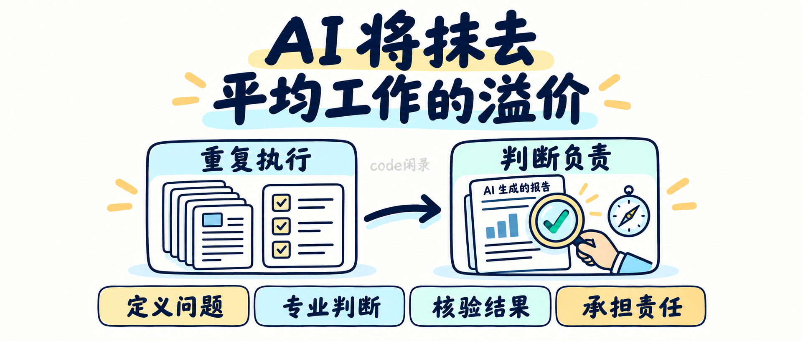

# AI 正在让“合格”贬值：你靠什么保住工作的溢价？

**当第一份像样的结果越来越便宜，职场人需要重新回答：别人为什么愿意为你的工作付费？**

原文启发：Asher Adeniyi｜AI Will Erase Average Work（2026年9月18日）

**导语**

你花了一上午整理的汇报，AI 几分钟就能给出一份像样的初稿。你熟练使用的模板，新人也能借助工具迅速上手。

真正让人不安的，可能不是机器突然接管了整家公司，而是某一天，你发现自己最熟悉的交付物，已经很难说明自己的价值。

Asher Adeniyi 在原文中提出：AI 将侵蚀重复、可清楚描述、缺少独特判断的工作的价值。这首先涉及岗位内的任务重组，并不意味着普通员工会立刻失业。作者也把讨论延伸到 CEO：智能体可以辅助管理，但企业仍需提供可靠的业务背景、划清权限，并由人承担责任。

沿着这个判断，普通职场人更值得思考的是：**如果生成一份“合格答案”越来越容易，我们应该把自己的能力放在哪里？**

## 第一章、你交付的是文件，还是一个经过判断的结果？

以下是结合职场场景展开的讨论，例子为本文补充。

假设两位工程师都交出了一份故障分析报告。

第一份结构完整：现象、原因、解决方案，一项不少。第二份多回答了几个问题：故障是否能够复现？日志里缺了什么证据？提出的修复会不会影响其他设备？如果判断错了，怎样回滚？

两份文件可能一样漂亮，但它们对团队的作用不同。前者让人知道“报告写完了”，后者让人能够决定“接下来该怎么做”。

AI 可以帮助整理日志、列出假设、补全报告框架。工程师仍然需要确认：它引用的是哪个固件版本，时间戳是否对齐，所谓的根因是否有实验支持。

**交付物的完成度，不能代替结论的可信度。**重新看待自己的工作，可以从这里开始。

## 第二章、忙到没有时间思考，可能正是需要调整的信号

每周整理一次周报，是必要工作；每周都靠同一个人从五个系统里手动复制数字，则值得追问。

这里可以做一个小实验：把自己上周的工作分成“搬运信息”“整理表达”“判断取舍”三类，看看各自占了多少时间。

如果大部分精力都耗在前两类，先挑一个范围明确的小任务尝试改进。例如，让工具按固定格式汇总已经脱敏的故障记录，再由自己检查设备编号、问题分类和遗漏项。

先保留人工检查，记录实际节省的时间，也记录新增的核验成本。如果整理快了半小时，检查却多花一小时，这个方案就还没有成功。

这类尝试的意义，是让自己有机会把时间投入更值得解决的问题。比如，重复故障能否在测试阶段提前发现？客户为什么总是在相同环节操作出错？

## 第三章、熟练使用 AI，也需要拿得出证据

简历上写“熟练使用 AI”，很难让人判断你究竟改善了什么。

更有说服力的，是讲清一次真实的工作改进：原来哪里费时，你让工具负责了哪一段，怎样检验，遇到了什么错误，最终效果如何。

以测试用例为例，生成一百条看起来合理的用例并不难。真正需要检查的是：是否覆盖设备重启、通信中断、状态切换和异常恢复？有没有重复用例？预期结果是否能被实际观察和验证？

只有把生成结果放回项目约束里检验，工具的速度才可能转化为工程收益。

因此，学习工具时可以同时积累一份“错误笔记”：哪些条件容易被遗漏，哪些说法需要查证，哪些任务暂时不适合交给它。**能识别工具的失误，和能让工具产出一样值得训练。**

## 第四章、管理者也要回答：自己究竟做了什么判断？

如果一位经理每天主要收集进度、转发通知、催交材料，那么信息整理工具变强之后，他也需要重新解释自己的贡献。

管理工作中更难的部分，常常藏在冲突里：两项需求都很紧急，资源先给谁？交付日期与质量要求发生冲突，如何取舍？团队成员意见不一致，怎样确认争议背后的事实？

这些场景可以借助 AI 梳理选项，但最后仍需要具体的人作出决定、解释理由、跟进后果。

例如，工具根据现有数据建议压缩测试周期，负责人需要检查数据里是否包含新硬件批次的风险，以及这次压缩会把什么不确定性带到现场。

职位越高，越应该让判断的依据清楚可见。仅仅把机器给出的建议转述一遍，无法完成这份工作。

## 第五章、先把业务说清楚，再谈让智能体接手

设想团队准备让智能体自动整理项目状态。结果它发现：产品文档里的“完成”指开发结束，测试表里的“完成”指验证通过，客户邮件里的“完成”又指已经上线。

这时，继续优化提示词也许无法解决根本问题。团队需要先统一状态定义，确定哪份记录有效，并说明冲突时找谁确认。

一次小规模试用，可以先写清四件事：读取哪些材料，产出什么结果，谁来验收，遇到哪些情况交还人工处理。

比如，它可以准备延期风险清单，由项目负责人核对后再对外沟通。这样既能利用整理信息的速度，也能检验这套流程是否可靠。

**业务里原本含糊的地方，不会因为接入一个更聪明的模型就自动清晰。**把规则和依据整理好，本身就是有价值的工作。

## 第六章、从一件小事开始，重新积累自己的职业筹码

不必立即推翻整套工作方式。下一周，可以只完成一个小循环：

1. 选出一项重复任务，写清输入、输出和验收标准。
2. 在允许使用工具的范围内试一次，保留原流程作比较。
3. 核对结果，记录漏项、错误和实际耗时。
4. 修正方法，再把省下的精力用于一个更需要判断的问题。

持续留下这些记录，你就能逐渐回答：自己改善过什么，什么条件下有效，又知道哪些边界。

原文的标题是一种鲜明的趋势判断，不能据此推算某个岗位何时消失。但它提出的问题值得认真对待：当工具让基础交付变得更容易，我们准备怎样提高工作的标准？

**比“我能做完这件事”更有分量的职业证明，是“我能解释它为什么这样做，并验证它确实做对了”。**

---

原文：[AI Will Erase Average Work — Asher Adeniyi](https://asheradeniyi.com/2026/09/18/ai-will-erase-average-work/)

编写说明：本文提炼原文核心论点，并结合工程与职场场景作独立延伸，非逐段翻译。文中工程案例及实践步骤为补充讨论，不代表原作者亲历；未将原文涉及的就业暴露程度等同于失业概率。
