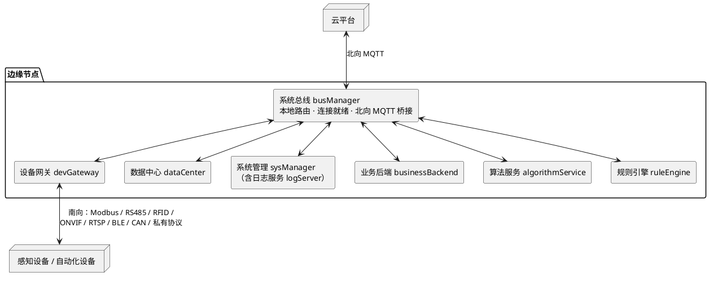
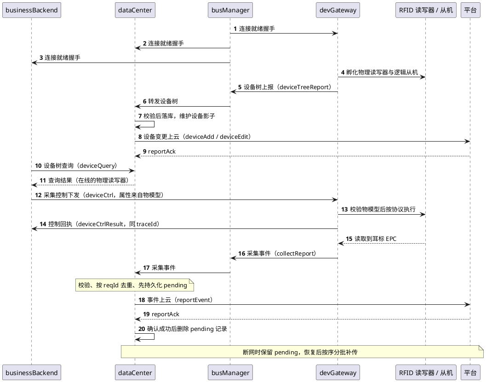

# 边缘 AI 网关系统设计方案

## 引言

边缘 AI 网关是现场设备与中心平台之间的关键一层：向下把多协议、多厂商的感知设备与自动化设备统一接进来，向上对接物联平台、数据中台与 AI 算法中台，并在本地完成数据采集、推理、策略执行与弱网自治。

系统的设计目标可以归纳为五条：

| 目标 | 说明 |
|---|---|
| 设备接入标准化 | 多协议、多厂商设备统一纳管；更换设备或协议时只改设备网关，其他环节零改动 |
| 数据模型标准化 | 原始报文在边缘侧即转为统一设备模型与统一消息，上游只面对一套格式编程 |
| 边缘自治 | 断网或平台不可用时，关键采集、推理、告警、控制照常运行 |
| 统一运维 | 远程配置、日志、指标、升级回滚、诊断与设备全生命周期管理 |
| 平台化复用 | 同一套边缘底座承载电子耳标、咳嗽识别、视觉识别、环控、自动化联动等不同项目 |

技术选型上，系统运行于 Linux，支持 C / C++ / Java / Python 等多语言实现；每个 App 是独立进程、单实例运行；App 之间的通信统一基于 Zenoh 二次开发的系统总线，与平台的通信统一经总线的北向 MQTT 桥接；日志则通过独立的日志 SDK 与日志服务旁路处理。

本文分两部分：第一部分给出整体框架设计——系统由哪些模块组成、各自的角色与职责边界、模块之间的整体关系；第二部分展开各模块的内部设计——模块内部如何组织、有哪些关键机制和主要流程。

---

# 第一部分　整体框架设计

## 一、架构总览

系统以边缘节点为单位部署，节点内部是一组独立进程（App），通过系统总线以发布/订阅方式协作，形成一个微服务化、事件驱动的本地系统。



三个特征决定了整体形态：

1. **按变化原因拆分进程**。设备接入、数据持久化、业务决策、算法分析、系统运维分别由不同 App 承担，每个 App 拥有清晰边界，通过稳定契约协作，而不是互相调用内部函数。
2. **以事件驱动协作**。一个服务产生事实或需要他人执行动作时发布一条消息，其他服务按订阅关系自主消费。一次业务动作通常由"命令 → 执行结果 → 业务数据事件 → 平台确认"串联而成。
3. **本地优先，最终一致**。边缘侧的实时业务不等待云端响应；云端不可用时本地继续运行，恢复后由数据中心补传，通过"至少一次投递 + 消费方幂等"收敛到最终一致。

## 二、模块组成：固化骨架与可插拔 App

模块分为两类：**固化骨架**是物联网基础能力，所有项目都必须存在；**可插拔 App** 随业务增删。

```text
固化骨架： busManager → dataCenter → devGateway
                   └── sysManager（含 logServer）
可插拔：   businessBackend · algorithmService · ruleEngine
```

| 中文名 | 代码名 | 类别 | 定位 |
|---|---|---|---|
| 系统总线 | `busManager` | 骨架 | 节点内统一通信底座 |
| 数据中心 | `dataCenter` | 骨架 | 本地数据缓存、查询与云端同步中心 |
| 设备网关 | `devGateway` | 骨架 | 总线与现场设备之间的南向适配层 |
| 系统管理 | `sysManager` | 骨架 | 节点统一运维底座，内含日志服务 `logServer` |
| 业务后端 | `businessBackend` | 可选 | 业务决策与流程编排 |
| 算法服务 | `algorithmService` | 可选 | 识别、预测、计算 |
| 规则引擎 | `ruleEngine` | 可选 | 规则判断与联动触发 |

命名约定：骨架模块一律使用上述中文名与代码名，不再使用其它别名。

## 三、各模块的角色与职责边界

职责边界的定义方式是同时写清"负责什么"与"明确不负责什么"，后者比前者更重要——它是防止职责外溢的依据。

| 模块 | 负责 | 不负责 |
|---|---|---|
| `busManager` 系统总线 | 本地发布/订阅路由、连接就绪握手、云端 Topic 适配与唯一北向出口 | 不解析业务载荷；不保存业务离线队列；不代替业务做幂等；不承载视频与大数据本体；不保证可靠上云 |
| `devGateway` 设备网关 | 设备孵化与设备树、在线状态、协议私有数据、物模型属性控制执行、采集事件生成 | 不访问云端；不做业务规则与设备选择；不做长期存储；运行时私有数据不对外暴露 |
| `dataCenter` 数据中心 | 设备影子与业务数据的本地持久化、基础查询、先持久化后发送、平台确认后清理、断网补传 | 不做协议解析与设备控制；不做业务规则、分析、推理、告警；不保存协议私有数据 |
| `sysManager` 系统管理 | 配置、日志（`logServer`）、指标、升级回滚、时间同步、进程守护 | 不参与任何设备与业务数据处理 |
| `businessBackend` 业务后端 | 业务规则与流程编排：查设备树选设备、何时下发什么控制、如何消费采集事件 | 不直接操作设备硬件；不自行维护设备或地址副本；不绕过数据中心重复向平台上报同一业务数据 |
| `algorithmService` 算法服务 | 识别、预测、计算并输出结果 | 不控制设备；不做业务决策 |
| `ruleEngine` 规则引擎 | 依据数据判断是否触发动作或告警 | 不解析设备协议；不直接写本地库 |

由此提炼出六条贯穿全局的边界原则：

1. **唯一责任方**。消息流转只由 `busManager` 负责；设备协议与设备控制只由 `devGateway` 负责；需要持久化的数据由 `dataCenter` 负责落库与上报。
2. **不共享运行时私有数据**。协议句柄、通信地址映射、会话与重试状态只留在所属模块内部，既不通过总线传递，也不落库。跨进程共享的只能是稳定的业务数据与标识。
3. **业务逻辑不外溢**。"这头猪该不该告警""该控制哪台设备"这类判断属于业务后端与规则引擎，不属于骨架模块。
4. **唯一上云通道**。`busManager` 是节点内唯一持有 MQTT 客户端的模块，任何模块与平台通信都必须经总线中转。但"上云资格"不与某一个 App 唯一绑定：`dataCenter` 负责需要持久化数据的上报，其它业务模块也可按自身职责经总线上云——前提是不重复上报同一业务数据。
5. **大数据旁路**。视频走 RTSP/WebRTC 直连，图像、点云、音频块走独立数据面，总线只承载控制、状态、遥测与结果类小消息，以及对大数据的引用与通知。
6. **边界由协议固定，不由示例固定**。`deviceCtrl`、`deviceReport` 等是通用接口，不因当前示例是 RFID 就退化为某一设备专用。

## 四、模块之间的整体关系

### 4.1 通信总则

- 所有跨模块通信都经 `busManager`，模块之间不建立私有进程间通信，也不直接耦合。总线不涉及任何业务，只提供一套面向协议的开发方式。
- 本地通信以 `intent`（订阅表达式）作为路由依据；消息体中的 `type` 只描述载荷语义，不参与路由。
- 消息使用统一信封，主要字段例如 `reqId`（业务幂等键）、`traceId`（调用链标识）、`type`、`timestamp`、`source`、`data`。
- 发布时以路由方向参数区分路径：本地方向在 App 间直接路由分发；云端方向表示平台业务动作，由 `busManager` 完成 Topic 适配与上行，业务方不直接连接 MQTT。
- 云边两级协议严格隔离：本地使用本地对接协议，平台使用平台对接协议，二者之间的适配由承担上云职责的业务模块（典型为 `dataCenter`）完成。
- 上行只保证"至少一次投递 + 业务幂等"，不假设恰好一次；平台的业务确认（`reportAck`）是唯一的业务成功标志，传输层投递成功不等价于业务成功。

### 4.2 消息的三种类型

| 类型 | 含义 | 示例 |
|---|---|---|
| 命令 | 请求某服务执行动作，需要幂等 | `deviceCtrl`：打开 RFID 采集 |
| 事件 | 已经发生的事实，允许多方订阅 | `collectReport`：读到一个 EPC |
| 结果 / 确认 | 对命令或上云业务的处理结果 | `deviceCtrlResult`、平台 `reportAck` |

发布者不需要知道有多少消费者，也不同步等待消费者完成。例如 `devGateway` 发布一次采集事件后，`dataCenter` 可以持久化并上云，`ruleEngine` 可以判断是否告警，`algorithmService` 可以做识别统计；未来新增消费者时不需要修改 `devGateway`。

### 4.3 幂等与追踪的责任分工

总线允许重复投递、不提供去重，因此幂等责任明确下放到消费方：

- **控制命令**按 `reqId` 幂等，由 `devGateway` 负责，避免同一命令重复操作硬件。
- **采集事件**的语义去重按 `reqId` 由 `dataCenter` 负责，去重窗口在数据中心配置；`devGateway` 侧"采集一次发布一次"，不做发布侧窗口去重。
- **平台侧**同样应按 `reqId` 保留去重记录，且保存时间不短于边缘最大补传窗口，避免补传造成重复入库。
- 同一次业务请求及其后续事件共用同一 `traceId`，把控制、回执、采集事件与上云记录串成一条链：`deviceCtrl → deviceCtrlResult → collectReport → reportEvent → reportAck`。补传只改变发送时间，不改变 `reqId`、`traceId`、业务数据与事件时间。

### 4.4 启动依赖顺序

```text
busManager ──► dataCenter ──► sysManager / 其他业务 App ──► devGateway
```

- `busManager` 必须最先提供可用的本地发布订阅能力。
- `dataCenter` 必须先创建并持久化根设备，并对外提供根设备 ID。
- `devGateway` 只有取得根设备 ID 后才能孵化设备并挂载设备树，避免设备节点缺少父节点。
- `sysManager` 与日志能力可与数据中心并行准备。
- 任何 App 都不得仅以"总线接入返回成功"判定业务可用，必须完成连接就绪握手后再启动业务流程。

### 4.5 三条独立的数据通道

系统刻意维持三条互不干扰的通道，这是整体架构的重要特征：

| 通道 | 走向 | 承载内容 | 设计理由 |
|---|---|---|---|
| 业务通道 | 经 `busManager` | 控制、状态、遥测、结果等小消息 | 统一路由与解耦 |
| 日志通道 | 经 `logSdk → spool 目录 → logServer` | 日志文本 | 日志不进总线，避免总线或日志服务异常时影响日志输出，也避免日志洪泛挤占设备控制与业务事件 |
| 大数据通道 | RTSP/WebRTC 直连、独立数据面 | 视频流、图像、点云、音频块 | 避免大流量占用总线；总线只传引用、通知与分析结果 |

运维类数据（配置、指标、升级、时间同步）与业务数据通道分离，弱网时不得挤占业务带宽。

### 4.6 一条完整业务链路

以电子耳标项目为例，设备树形如"根设备 → RFID 物理读写器 → RS485 逻辑从机"，一次完整流程的通信顺序为：



该链路体现的关键约定：控制必须走物模型且目标设备须在线、设备树须已同步；采集事件的各级设备标识必须一致以保证可追溯；失败时只返回失败回执，不伪造上报数据。

### 4.7 故障隔离

| 故障 | 处理方式 |
|---|---|
| 云端断网 | 本地事件继续流转，`dataCenter` 保留待上云记录，恢复后补传 |
| 北向桥接异常 | 不影响本地 App 之间的通信 |
| 总线重复投递 | 消费者按 `reqId` 幂等，总线本身不做去重 |
| 设备离线 / 协议执行失败 | `devGateway` 返回失败结果，不伪造采集事件 |
| 设备树未同步 | 业务后端不下发控制，先查询或等待同步 |
| 物模型不匹配 | `devGateway` 在访问硬件前拒绝命令 |
| 算法服务停止 | 只影响算法消费链路，不阻断设备采集与基础数据落库 |
| 日志服务停止 | `logSdk` 仍写本地 spool，日志写入不依赖总线或 `logServer` |
| 视频数据量过大 | 视频走独立通道，总线只传结果与引用 |

### 4.8 扩展方式

- **新增一种设备协议**：在 `devGateway` 中增加协议服务并注册一个 `engineType`，把协议报文转换为统一设备对象、物模型与标准消息，复用已有的设备树、总线、数据中心与业务服务。
- **新增一个业务项目**：复用固化骨架与消息信封，增加项目自己的业务后端、算法或规则服务，通过订阅已有事件、发布业务命令组合流程；只有在确实需要持久化与上云时才扩展数据中心的数据结构。

两条扩展路径共同支撑同一个稳定性目标：**设备变化不扩散到上层，业务变化不侵入设备接入层**。

---

# 第二部分　各模块内部设计

## 五、系统总线 `busManager`

### 5.1 内部划分

总线基于 Zenoh 二次开发：以 Zenoh 作为本地消息路由底座，在其之上实现服务端与 SDK，业务 App 不直接使用 Zenoh 原生接口。服务端是独立进程，SDK 随各 App 进程加载并以 Zenoh 客户端会话接入路由。

```text
系统总线（基于 Zenoh 二次开发）
├── 服务端（busManager 进程）
│   ├── 路由基础设施      启动、配置与守护 Zenoh 路由进程
│   ├── Zenoh 监听        维护自身会话与订阅，接收 SDK 提交的内部信封
│   ├── 连接就绪管理      校验就绪请求，返回就绪结果与可用资源范围
│   ├── 北向桥接（MQTT）  上行接入与信封解析、上下行 Topic 转换、唯一 MQTT 客户端
│   └── 运行管理          配置加载、日志与指标、启停与异常恢复
└── SDK（随 App 进程加载）
    ├── 接入与握手        打开本地会话、周期发起就绪请求、就绪前丢弃业务消息
    ├── 命令注册与订阅    按业务提供的订阅表达式建立订阅，保留就绪回调
    ├── 接收与回调调度    接收线程入队，工作线程按序执行回调
    ├── 发布              将业务载荷按指定表达式或北向路径发送
    └── 资源生命周期      句柄创建、线程回收与释放
```

服务端只处理路由与转换、不感知业务载荷内容，因此新增业务不需要修改服务端。SDK 只依赖服务端公开的通信契约（订阅表达式、内部信封、内部保留主题），不依赖其内部实现；服务端也不依赖 SDK 内部结构。二者构成松耦合的客户端—服务端关系，可分别演进。

### 5.2 核心抽象

框架只抽象三个对象：

```text
业务参数（reqId / 路由方向 / 订阅表达式 / 业务载荷）
        ↑
     内部信封
        ↑
  路由（本地订阅表达式 / 北向路径）
```

- **路由方向**：区分本地与北向两条路径，是发布的调用参数，也是内部信封的字段；它不写入业务载荷，也不拼接到订阅表达式或北向路径中。
- **订阅表达式**：本地路由时它就是完整的订阅表达式，由本地对接协议定义名称与层级，总线不增加前缀、不拼接层级、不做映射；北向路由时它表示北向事件标识，由平台对接协议定义，并由北向桥接负责与北向路径互相转换。
- **内部信封**：SDK 与服务端之间的内部传输结构，承载消息类型、路由方向、原始表达式、业务载荷及其长度、`reqId` 等字段。它是框架内部格式，不改变业务载荷内容；北向消息的解析与转换只在北向桥接内完成。

### 5.3 连接就绪机制

连接就绪是 App 业务可用的前置条件：App 完成总线接入后先发起就绪请求，收到就绪结果后才启用业务回调与消息分发；就绪结果同时给出该 App 可用的资源范围。就绪回调在所有业务消息之前送达，保证 App 在启用业务前先完成初始化动作。断连或路由重启后必须重新握手。

### 5.4 通信模型

**本地发布订阅**：调用方提供的表达式直接决定接收者，SDK 不做任何转换，路由方向也不参与本地匹配；实际匹配与分发由 Zenoh 路由完成，服务端不解析普通 App 间的本地消息。同一表达式可以注册多个命令项，接收方按注册顺序依次执行，单个回调失败不影响后续回调，也不破坏接收线程。

**北向通路**：

```text
上行：App → SDK → 内部保留主题 → 北向桥接 → 云端
下行：云端 → 北向桥接 → 本地表达式 → 订阅该标识的 App
```

上行时业务以北向方向发起发布，SDK 将内部信封投递到内部保留主题（该主题不属于业务主题，业务 App 不直接订阅或调用），北向桥接解析信封、还原北向事件标识并生成北向路径后经 MQTT 客户端发送。下行时北向桥接解析出事件标识并以其作为本地表达式发布，业务载荷保持不变，接收者完全由本地订阅关系决定，桥接不维护"北向路径 → 目标 App"的映射。上下行使用同一事件标识语义，因此无需额外映射表。

框架不规定平台下行消息必须先经过哪个 App——是否需要由某个 App（例如 `dataCenter`）先做校验再转发，完全由业务流程定义。

### 5.5 运行时模型

- **进程结构**：单实例进程，并负责启动与守护本地路由进程；每个 App 进程加载一个 SDK 句柄。
- **SDK 线程**：一个握手线程按退避周期重发就绪请求；一个工作线程按序执行回调；底层会话回调只做入队，不执行业务逻辑，避免阻塞接收。
- **服务端线程**：Zenoh 监听、就绪处理与北向桥接各自独立，互不阻塞。
- **停机**：停止信号先置位并唤醒等待线程，回收工作线程与句柄，再释放本地会话；北向客户端异常或云端不可用不应导致服务端退出。

### 5.6 能力边界

发布成功只代表本地发送已受理，不代表北向客户端已发送、云端已接收或平台业务已处理；需要可靠上云的消息由业务端自行持久化、重试与确认。本版本只提供异步发布订阅，同步请求/回复能力已从框架移除，需要取得结果的场景由业务方基于事件与 `reqId` 自行关联。总线不保证实时性与严格时序，允许重复投递。大数据不得编码为文本填入消息，共享内存句柄不得用于跨节点或上云传递；固定的一对一图像链路使用独立共享内存环形缓冲区，总线只承载就绪、确认与结果通知。本地权限控制不属于当前版本，就绪结果下发的资源范围仅作为约定，后续可在不改变业务调用方式的前提下补充。认证凭据、设备密钥等敏感信息不得进入业务消息、日志与链路追踪。

## 六、设备网关 `devGateway`

### 6.1 内部划分

框架自上而下分为四层，职责单一、单向依赖：

```text
设备网关（devGateway）
├── 总线接入      连接就绪握手、下行命令注册与消息转换、上行消息发布
├── 消息分发      下行队列与处理线程、上行队列与处理线程
├── 设备管理      设备孵化与注册、设备缓存与查询、设备树与在线状态、物模型属性
└── 协议转换      按 engineType 注册协议服务，提供 set / read / report 三类能力
```

依赖方向固定为：协议转换 → 设备管理 → 消息分发 → 总线接入。上层只通过统一的设备对象与内部消息访问下层能力，协议服务之间互不感知。总线接入不解析业务语义、不做设备查找；消息分发不直接调用设备、不做协议解析；设备管理不感知协议细节、不保存协议私有数据；协议转换不维护设备树、不直连总线。

### 6.2 核心抽象

```text
ServerHdl_t  ←（engineType）─  device_t  ←（deviceId）─  dg_message_t
```

- **`ServerHdl_t`**：描述一种设备协议如何执行控制、读取和上报，对外只暴露 `set`、`read`、`report` 三类能力。
- **`engineType`**：协议服务的唯一编号，是"设备"与"协议"之间的唯一绑定点。
- **`device_t`**：描述一个具体设备，承载业务可见信息与协议侧信息，并通过父子关系组成设备树。
- **`dg_message_t`**：模块内部以及模块与总线之间传递的消息载体，携带消息类型、来源、目标、`reqId`、业务参数与进程内临时数据。

设备网关本身不关心底层是哪种协议，只依赖 `device_t` 与 `engineType` 完成路由。

**设备对象的两侧关注点分离**：业务层只关注设备标识、设备类型、模型属性、在线状态；协议层只关注协议内唯一标识、协议地址、`engineType` 与协议私有数据。模型属性描述"设备现在是什么状态"；协议运行态（句柄、会话、解析缓存、重试状态）一律放在协议私有数据中，不进入模型属性，也不对外暴露。

**设备树**用父子关系表达真实的物理接入拓扑，并用标记区分物理设备与逻辑设备。例如 RFID 读写器本身是物理设备，挂在其下的天线或 RS485 从机是逻辑设备：逻辑设备不重复占用物理接入资源，但可作为独立可寻址节点参与查询与控制。

### 6.3 主要流程

**设备孵化与注册**——协议服务负责孵化自己管理的设备，框架统一负责纳管：

```text
协议服务初始化 → 按协议发现设备 → 创建 device_t
→ 填写 engineType 与协议侧字段 → 加入设备缓存
→ 按 parentId 挂载设备树 → 上报设备树到总线
```

协议服务负责填写协议内唯一标识、协议地址、`engineType` 与协议私有数据；框架统一负责设备缓存、设备查询、设备树、在线状态维护与设备树上报。孵化只有在取得根设备 ID 之后才能进行。

**下行链路**——概括为"消息 → 找设备 → 找协议 → 执行动作"：

```text
总线消息 → dg_message_t → 下行队列 → 处理线程
→ 按 deviceId 查找 device_t → 按 engineType 定位 ServerHdl_t
→ set / read → 感知 / 自动化设备
```

处理线程负责路由与校验，真正的协议动作在协议服务内执行。控制必须收敛到物模型：只接受目标设备物模型中存在且可写的能力，非法命令直接拒绝、不触碰硬件。对不支持该控制的逻辑从机下发时同样返回失败。

**上行链路**——概括为"设备数据 → 协议解析 → 标准消息 → 系统总线"：

```text
感知 / 自动化设备 → 协议服务 report → dg_message_t → 上行队列
→ 处理线程 → 总线信封转换 → 总线 → dataCenter / ruleEngine / algorithmService 等订阅方
```

协议服务只负责把原始数据翻译成统一消息，后续分发完全交给总线。两条链路方向相反、互不阻塞。

### 6.4 运行时模型

单进程单实例运行，一个主线程加若干工作线程。主线程负责信号处理、建立并维护总线连接、启动与回收工作线程，不处理设备业务；下行与上行各由独立线程驱动，通过各自队列解耦总线收发与设备访问，避免协议阻塞影响消息接收。完成连接就绪握手后才开始孵化设备与接收控制命令，未就绪时按退避重试。停机时通知工作线程，等待正在执行的协议动作结束，再释放总线连接。

### 6.5 能力边界

只做设备接入、控制执行与事件生成，不判断"该控制哪台设备"、不做告警、不做分析、不做持久化。新增协议只需注册一个 `engineType` 与对应协议服务，不修改消息分发与设备管理逻辑。控制命令按 `reqId` 幂等由本模块保证；事件的语义去重由 `dataCenter` 负责，本模块只保证同一事件不重复生成。采集一次发布一次，高频原始数据如需降频可在协议服务内做周期汇总，汇总结果视为一次新的采集事件。设备离线、物模型不匹配或协议执行失败时只返回失败结果，不伪造上报事件。协议句柄与地址映射仅存在于进程内，进程重启后需重新建立。受协议轮询周期、队列积压与设备响应时间影响，控制与上报存在固有延迟。最小版本不包含动态入网发现、按需加载协议驱动与协议热更新。

## 七、数据中心 `dataCenter`

### 7.1 内部划分

```text
数据中心（dataCenter）
├── 总线接入        连接就绪握手、命令注册与消息转换、上行消息发布
├── 设备影子        根设备初始化、设备增删改、设备云端同步、设备树查询
├── 业务数据管理    数据初始化、增删改、云端同步与查询；事件校验、按幂等键去重、生成待上云报文
└── 存储管理        SQLite 初始化，提供数据库能力、事务与容量控制
```

各组件单向依赖：总线接入 → 设备影子 / 业务数据管理 → 存储管理。新增业务只扩展数据结构与订阅关系，不改变接入与同步框架。总线接入不解析设备协议、不生成业务数据、不强制中转其它 App 的下行消息；设备影子不感知协议细节、不做设备控制；业务数据管理不做业务规则判断与数据分析；存储管理不向上暴露存储细节、不保存运行时私有数据。

### 7.2 存储设计

本地存储统一使用 SQLite：数据量不大、单机部署、以缓存和查询为主，不需要分布式能力，因此不引入额外的数据库或缓存组件，也不预置时序库、对象库、数据湖、冷热分层或多级缓存。

当前只维护两张明确的表：

- **设备影子表**：设备树节点的持久化视图，保存标识、父设备标识、模型标识、设备类型、在线状态、物理/逻辑标记、协议编号、属性等。属性整体以 JSON 文本保存，不拆成独立字段。
- **待上云表**：保存尚未收到平台确认的上行报文，包含 `reqId`、`traceId`、上行意图、平台报文、状态与创建时间。

只保存需要恢复或查询的信息：协议私有数据与设备之间的指针关系属于设备网关的运行时状态，没有持久化价值，不入库。出现新的业务缓存需求时再增加对应的表。

### 7.3 核心抽象

```text
总线消息（设备变更 / 采集事件） → 数据记录（设备影子 / 待上云报文） → 本地存储
```

- **根设备**：本机在设备树中的锚点，由数据中心初始化时创建并持久化，是所有物理设备的父节点，其标识对外提供。
- **设备影子**：设备树节点在本地存储中的持久化视图，是设备树查询与设备云端同步的唯一数据来源；协议运行时状态不进入影子。
- **待上云报文**：以 `reqId` 为幂等键的上行记录。记录存在即表示尚未收到平台确认；报文内容在补传时保持不变，不因发送时间改变而重写。
- **平台确认**：唯一的业务成功标志。只有收到与记录匹配的成功确认才允许清理该记录。

### 7.4 主要流程

**设备树接入**：收到设备变更后先按设备标识查询再写入，不存在则新增、已存在则更新，保证同一设备只保留一条记录；设备树发生新增或变更时据此派生出待上云报文，使平台侧设备信息与本地保持一致。

**采集事件上行**（Outbox 模式）：

```text
采集事件到达 → 校验、按 reqId 去重 → 写入待上云队列（pending）
→ 经总线发送平台报文 → 收到平台确认 → 删除记录
```

先持久化再发送，用于消除"已发送、确认未到、进程崩溃"造成的丢失窗口。待上云队列保存的是尚未确认的报文，而不是全部业务历史；确认成功的记录随即删除，本地不保留已完成的业务历史。同一读写器同一业务键在去重窗口内只产生一条待上云记录，去重窗口由本模块配置。

**断网恢复补传**：

```text
云端通信恢复 → 按记录顺序分批读取 → 批量发送
  ├── 确认成功 → 立即删除，继续下一批
  └── 失败 / 未确认 → 保留记录，停止本轮，退避后重试
```

分批读取避免一次性把大量记录加载到内存，批次大小按平台接收能力调整；网络未恢复时不发送，记录保留在队列中等待。补传只改变发送时间，不改变 `reqId`、`traceId`、业务数据与事件时间。实时数据优先补传。

**设备树查询**：其它 App 通过总线查询设备树或设备信息，本模块在本地存储中检索并返回，不触发任何设备访问。这是业务后端定位可控制设备的唯一来源，业务方不得自建设备地址副本。

**平台下行**：平台下行消息由北向桥接按本地表达式发布。本模块只订阅自身需要处理的下行消息；若业务流程规定下行先经本模块校验（主题、租户、边缘标识、报文）再转发，这属于业务约定，不是框架强制路径。

### 7.5 运行时模型

单进程单实例运行。总线回调只做入队与轻量校验，实际处理由工作线程完成，避免阻塞消息接收；上行同步业务按周期驱动，无待办时休眠、有记录时按批次发送。存储访问统一串行化并置于事务中，保证写入与淘汰的原子性。启动时先在总线连接就绪后创建并持久化根设备，再对外提供根设备 ID 并开始处理业务消息；停机时先置位停止信号，等待当前批次处理结束，保证已落库记录不因退出而丢失。

### 7.6 能力边界

磁盘空间不足、写入失败、容量淘汰都会丢弃最旧的待上云记录，本地存储损坏也会造成缓存丢失。待上云记录设有上限，超限时按"删除最旧、保留最新"淘汰，不删除正在发送的记录，并记录告警。云端可见时间包括去重窗口、批次等待、发送与平台处理耗时；断网期间本地仍可写入与查询。补传顺序为记录写入顺序，系统时钟调整可能造成事件时间回退。本地存储可被有权限的进程修改或删除，不作为不可篡改凭证，不适用于审计。协议私有数据、设备密钥与认证凭据不得写入本地存储或日志。

## 八、系统管理 `sysManager` 与日志服务 `logServer`

`sysManager` 是节点统一运维底座，负责配置、日志、指标、升级回滚、时间同步与进程守护，不参与任何设备与业务数据处理；其运维通道与业务数据通道分离，弱网时不得挤占业务带宽。本版本对其它运维职责暂不展开，只给出内含的日志服务设计。

### 8.1 架构与文件协议

日志能力由两部分组成：`logSdk` 随 App 进程加载，提供初始化与分级写日志接口；`logServer` 是独立进程，负责合并、压缩并上传本地日志。二者通过 spool 目录解耦，不使用 IPC，也不经过系统总线：

```text
app → logSdk → spool 目录 → logServer → 云端
```

这样做的原因是 `logServer` 故障不能阻断日志写入，因此 SDK 与 Server 之间不建立同步依赖；App 只需使用日志接口，不处理格式、路径、滚动与上传。

文件名承载状态：正在写入的文件与已封口可处理的文件用后缀区分（例如 `.log` 与 `.log.done`），文件名中携带 app 名、PID、毫秒时间戳与序号以区分实例与文件。同一 app 同时只运行一个进程，SDK 在滚动或反初始化时原子重命名封口；初始化时检查该 app 上次留下的未封口文件并先行封口，由于不存在并行写入进程，封口不会与该 app 的其他活进程竞争。文件名冲突时递增或重新生成序号，避免 PID 复用或时钟回拨导致覆盖。Server 只处理已封口文件，不负责封口。

### 8.2 `logSdk`：写入、滚动与降级

日志采用单行文本格式，按固定字段顺序排列（例如时间戳、级别、应用名、PID、文件行号、消息），消息中的分隔符需转义或替换。文件按跨小时与尺寸上限滚动，进程退出时封口。写入采用同步方式，不设异步队列：格式化在锁外完成，互斥锁保护滚动判断与写入，保证同一进程内日志行不交错，不依赖文件系统提供跨进程整行原子性。

SDK 定期检查磁盘空间。达到 spool 配额或系统剩余空间低于门槛时，按最旧优先淘汰已封口文件（包括已被 Server 认领的文件）直到有足够空间，但不删除正在写入的活跃文件；若仍无足够空间则放弃本次写入并累计丢弃数。初始化失败、空间不足或写入失败时尝试写 stderr，不向调用方抛异常，也不重试文件写入。

### 8.3 `logServer`：认领、合并与上传

工作循环为：认领一批已封口文件，合并并压缩到临时目录，上传；成功后删除源文件与压缩包并继续下一批，失败则删除压缩包、保留源文件，指数退避后重试（重试间隔设上限）；无数据时休眠。批次同时限制文件数与总字节数，达到任一上限即停止收集。

认领动作为原子操作（例如移入同一文件系统内的认领目录），认领记录须在 Server 重启后可恢复，且须容忍被认领文件在空间淘汰中被删除。空间充足时，认领或上传失败不导致源文件丢失；上传明确成功后才删除源文件。

App 崩溃后留下的未封口文件由该 app 下次初始化时封口，Server 不按文件修改时间封口，也不做 PID 存活检查。

### 8.4 能力边界

磁盘满、写入失败、配额淘汰或进程被强制终止都可能造成日志丢失。持续运行的进程通常在跨小时或尺寸滚动后才上传，云端可见时间还包括扫描与上传耗时，因此不保证实时性；多文件合并依赖各自时间戳，时钟调整可能导致时间回退，不保证严格时序。有权限的本地进程可修改或删除日志，不适用于审计。同步写在文件系统异常时会拖慢调用线程，高实时性路径应限制日志频率、记录周期汇总而非逐帧写日志。崩溃日志的上传存在延迟：在 app 重启并封口前不会进入上传队列。最小版本不包含实时推送、检索、告警、多网关聚合与审计级防篡改；后续的告警、trace 或实时监控应由独立消费者实现，保持日志服务专注于上传。

## 九、可插拔业务 App

业务类 App 不属于固化骨架，按项目增删，但同样遵循统一的通信契约与边界原则。

- **`businessBackend` 业务后端**是业务决策者与流程编排者：通过数据中心查询设备树选择目标设备，决定何时下发什么控制，并消费采集事件驱动后续流程。它不直接操作设备硬件，不自行维护设备或地址副本，下发控制前必须确认设备树已同步且目标设备在线，控制属性必须来自目标设备的物模型。
- **`algorithmService` 算法服务**订阅总线上的数据做识别、预测与计算并发布结果。它不控制设备、不做业务决策。视频类分析从独立媒体通道取流、在本地抽帧分析，只把结果发布到总线。
- **`ruleEngine` 规则引擎**依据数据判断是否触发动作或告警，不解析设备协议、不直接写本地库。

三者与数据中心的关系遵循同一条约定：它们可以直接订阅设备网关发布的事件做实时处理，但不得因此重复向平台上报同一业务数据。
